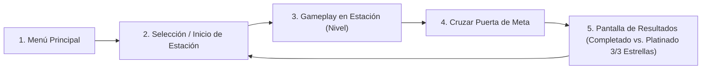

# Game Design Document (GDD) — NostalgIA

**Motor y Pipeline:** Unity 6.3.7f1 — Universal Render Pipeline (URP)  
**Plataformas Objetivo:** PC y Dispositivos Móviles (con soporte nativo para Mando de Xbox en ambas)  
**Género:** Plataformas 3D en Primera Persona / Acción y Resolución de Obstáculos con Física  

---

## 1. Concepto General

### 1.1. Resumen del Juego
*NostalgIA* es un videojuego de plataformas 3D en primera persona centrado en el movimiento fluido, la precisión y la resolución de obstáculos físicos mediante dos herramientas principales: un **Gancho** que permite adherirse e impulsarse hacia determinadas superficies del escenario, y una **Aspiradora Lanzadora de objetos**, capaz de recolectar elementos del entorno para almacenarlos y convertirlos en proyectiles con los que romper obstáculos, activar mecanismos, combatir enemigos o abrir nuevas rutas de formas creativas.

El jugador controla a un **dron robot con forma de cámara**. Aunque su modelo tridimensional no es directamente visible en cámara subjetiva durante la partida normal, su presencia física en el mundo se percibe de manera indirecta a través de su sombra proyectada, los reflejos del escenario, el brazo/herramienta equipada y las secuencias de muerte.

El objetivo principal de cada nivel (denominado **Estación**) consiste en atravesar secciones de plataformas y obstáculos hasta cruzar la puerta de meta final. Adicionalmente, cada Estación cuenta con **estrellas coleccionables** distribuidas en rutas opcionales o de mayor destreza; recolectar todas las estrellas permite completar al 100% o "platinar" el nivel.

### 1.2. Público Objetivo
Adultos jóvenes de entre **20 y 35 años** que crecieron durante la época dorada del internet (finales de los años 90 hasta principios de la década de 2010). Presentan afinidad por los videojuegos independientes experimentales, la estética surrealista digital (*Webcore*, *Frutiger Aero*, *Vaporwave*, *Dreamcore*) y la música electrónica/tecnológica. Son estudiantes y jóvenes profesionales residentes en zonas urbanas de alto desarrollo que buscan experiencias audiovisuales distintivas y dinámicas.

### 1.3. Plataformas y Enfoque Técnico
* **PC** (Teclado/Mouse y Mando de Xbox).
* **Dispositivos Móviles** (Controles táctiles en pantalla y Mando de Xbox).

El desarrollo se realiza sobre **Unity 6.3.7f1 utilizando Universal Render Pipeline (URP)**, diseñando la arquitectura gráfica para mantener un rendimiento fluido en dispositivos móviles mientras se aprovechan las capacidades de iluminación, shaders y postprocesado en equipos de escritorio.

### 1.4. Inspiraciones y Referencias Visuales / Mecánicas

| Referencia | Tipo de Influencia | Descripción y Elementos Retomados en *NostalgIA* |
| :--- | :--- | :--- |
| **Portal** | **Referencia Principal de Mecánicas** | Plataformas 3D en primera persona donde la prioridad es superar cámaras de prueba y resolver rompecabezas espaciales y físicos con una herramienta dual, más allá de ser un shooter convencional. *(Referencias visuales en PDF: cámaras de prueba modulares con cubos físicos, botones de presión y portales).* |
| **ENA (Joel G)** | **Inspiración Visual Principal** | Serie de animación independiente caracterizada por una estética *Webcore* y *Vaporwave* que combina elementos 2D y 3D dentro de mundos virtuales *low poly* surrealistas, integrando iconografía tecnológica retro (Windows XP y sistemas operativos clásicos). *(Referencias visuales en PDF: pasillos con texturas de código azul en techo y suelo, personajes 2D/pixel art como un mago sobre plataformas geométricas, colinas poligonales turquesa/verde bajo cielos cian y praderas surrealistas bajo domos geodésicos).* |
| **Smash Hit** | Interacción Física y Destrucción | Juego 3D en primera persona basado en lanzar proyectiles físicos para fracturar y derribar obstáculos cristalinos/geométricos en el camino. *(Referencia visual en PDF: pasillo piramidal azulado con cristales fracturándose por impacto de esferas metálicas).* |
| **Fall Guys** | Diseño de Obstáculos y Color | Plataformas 3D con obstáculos dinámicos, colores vibrantes y elementos decorativos inesperados (como frutas u objetos cotidianos fuera de escala) que contrastan con el recorrido. |

---

## 2. Mecánicas de Juego

### 2.1. Descripción General
La jugabilidad se desarrolla íntegramente en primera persona y se fundamenta en la sinergia entre el **sistema de movimiento avanzado** (caminar, correr, saltar, agacharse, deslizarse y control aéreo) y el **uso alternado de las dos herramientas** (Aspiradora Lanzadora y Gancho) para interactuar físicamente con el entorno.

### 2.2. Movimiento del Jugador
* **Movimiento básico y Control aéreo:** Desplazamiento libre sobre superficies transitables. El control direccional permanece activo en el aire y durante el uso del gancho, permitiendo modificar la trayectoria del impulso, esquivar obstáculos aéreos y alcanzar plataformas laterales.
* **Control de cámara:** Vista directa en primera persona con sensibilidad configurable. Puede orientarse libremente mientras se mantiene activa la absorción de la Aspiradora Lanzadora para barrer visualmente una zona y recolectar múltiples objetos en secuencia.
* **Salto:** Permite superar desniveles y se combina con la carrera, el deslizamiento y la cancelación del gancho para conservar e incrementar el *momentum* (impulso).
* **Correr:** Incrementa la velocidad de desplazamiento y actúa como requisito previo para activar el deslizamiento.
* **Agacharse:** Reduce la altura del colisionador y la cámara del jugador para atravesar conductos o zonas bajas.
* **Deslizamiento (*Slide*):** Al presionar la acción de agacharse mientras se está corriendo, el jugador entra en un deslizamiento que conserva la inercia de velocidad y reduce su altura temporalmente, manteniendo el flujo rápido de navegación.

#### Tabla de Controles de Movimiento
| Acción | PC | Dispositivo Móvil | Mando Xbox |
| :--- | :--- | :--- | :--- |
| **Pausa** | `Esc` | Botón de pausa en HUD | `Start` |
| **Movimiento** | `W` `A` `S` `D` | Pad virtual izquierdo | Stick izquierdo |
| **Mover cámara / Mirar** | Mouse | Deslizar el dedo en pantalla | Stick derecho |
| **Saltar** | `Espacio` | Botón en pantalla | Botón `A` |
| **Correr** | Mantener `Shift` | Llevar el pad izquierdo hasta arriba | Mantener presionado click en Stick izquierdo (`L3`) al moverse |
| **Agacharse** | `C` (configurable) | Botón en pantalla | Click en Stick derecho (`R3`) |
| **Deslizarse** | Agacharse mientras se corre | Agacharse mientras se corre | Click en Stick derecho (`R3`) mientras se corre |

---

### 2.3. Herramientas de Interacción

El jugador dispone de dos herramientas principales e intercambiables, de las cuales **solo una permanece activa a la vez**:
1. **Aspiradora Lanzadora**
2. **Gancho**

*(Nota de UX en móvil: El comportamiento del pad/botón derecho táctil se adapta dinámicamente según la herramienta activa).*

#### Enfriamiento (*Cooldown*)
Tras utilizar el Gancho, existe un breve tiempo de enfriamiento mientras el ducto mecánico se retrae a su posición original antes de poder volver a disparar el gancho o activar la aspiradora.

#### A. Aspiradora Lanzadora
Permite absorber objetos físicos compatibles del escenario, almacenarlos en una **pila FIFO (*First In, First Out*)** y dispararlos posteriormente como proyectiles físicos. **Restricción:** No puede absorber enemigos directamente.
* **Absorción:** Al mantener presionada la acción, se genera un cono/vórtice de atracción frente al jugador que arrastra los objetos compatibles hacia la boquilla.
* **Almacenamiento y Retroalimentación Visual 3D (Inflado):** Los objetos absorbidos se guardan hasta alcanzar una **capacidad máxima**. Esta capacidad se comunica diegéticamente en el propio modelo 3D de la herramienta: **conforme se almacenan objetos, una sección/depósito de la aspiradora se infla progresivamente** (mediante deformación de malla / shader / blendshapes) hasta alcanzar su volumen máximo, indicando visualmente que está llena sin saturar el HUD.
* **Disparo y Usos Físicos:** Los objetos se disparan individualmente conservando sus propiedades físicas para:
  * Atacar y eliminar enemigos.
  * Romper obstáculos frágiles o barreras.
  * Activar botones y mecanismos por impacto.
  * Empujar, derribar o desplazar elementos pesados para despejar caminos o resolver acertijos físicos.

#### B. Gancho
Herramienta principal de movilidad vertical y horizontal. Permite adherirse a superficies compatibles dentro de un **alcance máximo** (comunicado visualmente por la longitud del ducto/cable del gancho). **Restricción:** No permite adherirse a enemigos.
* **Activación y Retracción:** Si el disparo impacta una superficie compatible dentro del rango, establece el anclaje y aplica una fuerza de tracción que impulsa al jugador hacia el punto. Si no alcanza nada o choca con una superficie incompatible, se retrae sin aplicar impulso.
* **Cancelación y Conservación de Impulso:** El jugador puede cancelar el gancho en cualquier instante volviendo a presionar el botón de acción, liberando el anclaje pero **conservando el vector de velocidad acumulada** para encadenar saltos largos (*swing/slingshot*).

#### Tabla de Controles de Herramientas
| Acción | PC | Dispositivo Móvil | Mando Xbox |
| :--- | :--- | :--- | :--- |
| **Cambiar herramienta** | `F` (configurable) | Botón de cambio de herramienta | Botón `Y` |
| **Absorber objetos** | Mantener Click Derecho | Mantener presionado el pad derecho | Gatillo Izquierdo (`LT`) |
| **Disparar objeto** | Click Izquierdo | Presionar una vez el pad derecho | Gatillo Derecho (`RT`) |
| **Usar gancho** | Click Derecho | Botón de gancho | Gatillo Derecho (`RT`) |
| **Cancelar gancho** | Volver a presionar Click Derecho | Volver a presionar botón de gancho | Volver a presionar Gatillo Derecho (`RT`) |

---

### 2.4. Sistema de Progresión y Economía de Herramientas
Al tratarse de un juego de plataformas de acción por estaciones, la economía y progresión se basan en **estrellas coleccionables** (recompensa de maestría/exploración) y **mejoras permanentes de herramientas** otorgadas al completar el objetivo principal de cada Estación:
1. **Mejora de alcance del Gancho:** Incrementa la distancia máxima de conexión del ducto, abriendo rutas más lejanas en niveles avanzados.
2. **Mejora de capacidad de la Aspiradora Lanzadora:** Incrementa el número máximo de objetos almacenables simultáneamente.
* **Reflejo visual:** Toda mejora de progresión se refleja visualmente en el comportamiento y escala/capacidad del modelo 3D de la herramienta.

---

### 2.5. Sistema de Vida, Daño y Respawn
* **Corazones de vida:** El jugador cuenta con un indicador de corazones de vida. Los ataques enemigos y obstáculos reducen uno o más corazones. Al llegar a `0 corazones`, el jugador muere y reaparece en el último **punto de respawn (*Checkpoint*)** activado en la Estación.
* **Muerte Instantánea (*Instakill*):** Determinados peligros ignoran los corazones restantes y provocan muerte inmediata y reaparición en el último *checkpoint*:
  * Caer al vacío o desde alturas extremas.
  * Contacto con superficies/objetos de letalidad crítica o enemigos de muerte instantánea (como el Antivirus).

---

## 3. Narrativa, Personajes y Enemigos (Bestiario Digital)

### 3.1. Sinopsis y Contexto
El jugador controla un **dron cámara** enviado a explorar ecosistemas digitales dentro de la *World Wide Web*, operando de forma análoga a un *rover* espacial en un entorno inaccesible para los humanos. Durante la expedición se descubre que una **Inteligencia Artificial (IA)** diseñada originalmente para mantener el orden y las reglas de una región específica se ha salido de control, corrompiendo los distintos mundos virtuales para imponer una homogeneización absoluta. El objetivo del jugador es atravesar las cuatro Estaciones digitales y llegar al núcleo de la IA para detener la corrupción.

### 3.2. Personajes
* **Protagonista (El Dron Cámara / Robot):** Programa digital utilitario con forma de cámara robótica y cola/ducto articulado (inspirado estéticamente en cámaras de video Sony Handycam de los años 90/2000 combinadas con pequeños robots articulados tipo *Chibi-Robo* / *rover*). Carece de personalidad hablada ya que actúa como el avatar directo del jugador.
* **Antagonista Principal (La IA):** Programa de control masivo que, más que un personaje individual, se manifiesta a escala arquitectónica como un laberinto viviente de monitores CRT, ojos digitales y placas base. Constituye el escenario y desafío final del juego (**Estación 4: Invierno**).

### 3.3. Enemigos y Comportamiento (IA)

| Enemigo | Rol y Mecánica | Referencia Visual y Estética (del GDD) |
| :--- | :--- | :--- |
| **1. Correo de Spam** | **Atacante a Distancia (*Ranged*):** Detecta al jugador como una fuente de datos/alimento y le dispara proyectiles para debilitar sus corazones de vida. | Sobres de correo electrónico alados / flotantes y enjambres de cursores de mouse pixelados de Windows. |
| **2. Bugs** | **Hostigador Terrestre (*Swarm / Melee*):** Pequeños programas creados por la IA para invadir los mundos y atacar por contacto o persecución rápida. | Insectos robóticos translúcidos de colores vibrantes inspirados en juguetes tecnológicos de los 2000 (*HEXBUG Micro Robotic Creatures*: escarabajos, arañas y larvas mecánicas). |
| **3. Troyano** | **Generador de Enemigos (*Spawner*):** Vehículo infiltrado que aparenta ser una estructura estática del escenario y libera oleadas de *Bugs* al detectar al jugador. | Caballo de Troya geométrico *low poly* (inspirado tanto en esculturas poligonales con compartimentos internos llenos de insectos como en el monumental *Caballito* amarillo de Sebastián en la CDMX). |
| **4. Antivirus** | **Amenaza Letal / Obstáculo Implacable (*Hazard / Instakill*):** Programa de defensa agresivo que ataca o aplasta cualquier programa desconocido sin distinción. | Híbrido surrealista entre el icónico icono de libros apilados de *WinRAR* con ojos y mandíbula dentada, cajas con dientes y el comportamiento de impacto de un *Thwomp* de Super Mario. |

---

## 4. Diseño de Niveles (Las 4 Estaciones)

### 4.1. Estructura General y Progresión de Dificultad
Cada nivel (Estación) posee una **estructura lineal con espacios abiertos a la exploración lateral**: un punto de inicio, segmentos separados por *checkpoints*, rutas alternativas con **estrellas coleccionables** (hasta 3 por nivel para "platinarlo") y una **puerta de meta final**.

La curva de aprendizaje introduce primero el movimiento básico, luego el uso individual del Gancho y la Aspiradora Lanzadora, y finalmente exige **bucles combinados (*loops*)**:
* `Saltar` -> `Engancharse en el aire` -> `Cancelar gancho para conservar impulso` -> `Alcanzar plataforma lejana`.
* `Absorber objetos en movimiento` -> `Disparar proyectil en pleno salto para destruir barrera o activar interruptor` -> `Deslizarse por compuerta antes de que cierre`.

### 4.2. Las 4 Estaciones del Juego

| Estación | Dificultad y Rol | Dirección de Arte y Estética | Elementos Visuales, VFX e Iluminación Clave |
| :--- | :--- | :--- | :--- |
| **Estación 1: Primavera** | **Baja (Tutorial):** Aprendizaje guiado de movimiento, gancho, aspiradora y primeros obstáculos/enemigos básicos. | **Webcore / Simulación Retro:** Espacio interior cerrado que emula una simulación temprana de computadora. | Columnas clásicas grises combinadas con techos y pisos de pantallas azules con código ASCII/binario desplazándose (*UV scrolling*), texturas pixeladas simples y geometría de bloques limpios. |
| **Estación 2: Verano** | **Media-Baja:** Nivel abierto y luminoso de inmersión en el "universo virtual" con mayor presencia de enemigos y saltos largos. | **Frutiger Aero / Collage Y2K:** Contraste intencional entre elementos realistas (árboles, nubes, agua cristalina) y colinas/edificios *low poly*. | Cielos intensamente azules y soleados, burbujas flotantes con shaders iridiscentes (*Fresnel*), peces voladores/acuáticos, destellos de lente (*Lens Flare* / *Bloom*) y vegetación vibrante. |
| **Estación 3: Otoño** | **Media-Alta:** Plataformas escasas y exigentes, mayor densidad de enemigos y atmósfera opresiva y fría. | **Dreamcore / Espacios Liminales / Vaporwave:** Escenarios surrealistas y solitarios sin una dirección obvia a simple vista. | Niebla volumétrica/densa (*Fog*), pasillos retorcidos con pisos de damero (ajedrez), bustos clásicos grecorromanos con pantallas de TV, paletas magenta/cian apagadas y arquitectura liminal. |
| **Estación 4: Invierno** | **Alta (Nivel Final / Jefe):** Laberinto cerrado y claustrofóbico de máxima exigencia mecánica frente a la IA antagonista. | **Motherboard Corrupta / Glitch:** Interior electrónico de una placa base gigantesca donde colisionan elementos corruptos de las estaciones previas. | Paredes de circuitos impresos verdes, torres de monitores CRT mostrando ojos vigilantes y alertas de error (`!`, `X`), chispas eléctricas, shaders de *glitch* / distorsión digital y aberración cromática. |

---

## 5. Interfaz y Experiencia del Usuario (UI/UX)

### 5.1. Diseño del HUD
El HUD mantiene el centro de la pantalla despejado para priorizar la lectura de plataformas en primera persona, mostrando únicamente:
1. **Corazones de Vida:** Ubicados en la parte inferior central (3 corazones con contorno claro e iconografía legible sin depender únicamente del color).
2. **Contador de Estrellas (`Stars: 0/3`):** Esquina superior derecha.
3. **Mira de Apuntado (*Crosshair*):** Retícula central minimalista que indica si un objeto es absorbible o si una superficie está dentro del rango válido del gancho.
4. **Botón de Pausa (`||`):** Esquina superior izquierda (especialmente accesible en pantallas táctiles).
5. **Indicador de Capacidad de la Aspiradora:** Representado primordialmente por el **inflado del modelo 3D de la herramienta** en la esquina inferior derecha, apoyado por indicadores visuales de carga sin mostrar una lista de inventario (dado que opera como pila FIFO).
6. **Controles Táctiles (Solo en versión Móvil):** Pads y botones semitransparentes en los extremos inferiores que no obstruyen la visión central y emplean iconografía universal (accesibilidad para daltónicos).

### 5.2. Flujo de Navegación de Pantallas

---

## 6. Estética, Dirección de Arte y Consideraciones Técnicas

### 6.1. Inconsistencia Estética Intencional (Collage Postmoderno Y2K)
Una seña de identidad central de *NostalgIA* es la **combinación deliberada de estilos gráficos y niveles de fidelidad visual** como tributo a la cultura digital Y2K (similar a *ENA* o *Hylics*):
* Convivencia de geometría *low poly* sin suavizado (*flat shading*), modelos 3D de aspecto realista, *sprites* 2D integrados en el espacio tridimensional (*billboards*) y texturas pixeladas o de interfaz retro.
* Esta mezcla no solo refuerza la narrativa de mundos digitales fragmentados por la IA, sino que **optimiza el presupuesto gráfico**: permite reservar los shaders complejos y mallas detalladas para los elementos focales mientras el entorno general mantiene un costo de renderizado muy bajo.

### 6.2. Presupuesto Técnico en Unity 6.3.7f1 (URP)
* Todos los materiales, shaders, sistemas de partículas, luces y volúmenes de postprocesado se diseñan bajo un perfil escalable en **URP** que garantice fluidez en **dispositivos móviles** y alta fidelidad visual en **PC**.
* Prohibición absoluta del sistema `Terrain` de Unity; toda superficie se modela como malla 3D optimizada.
