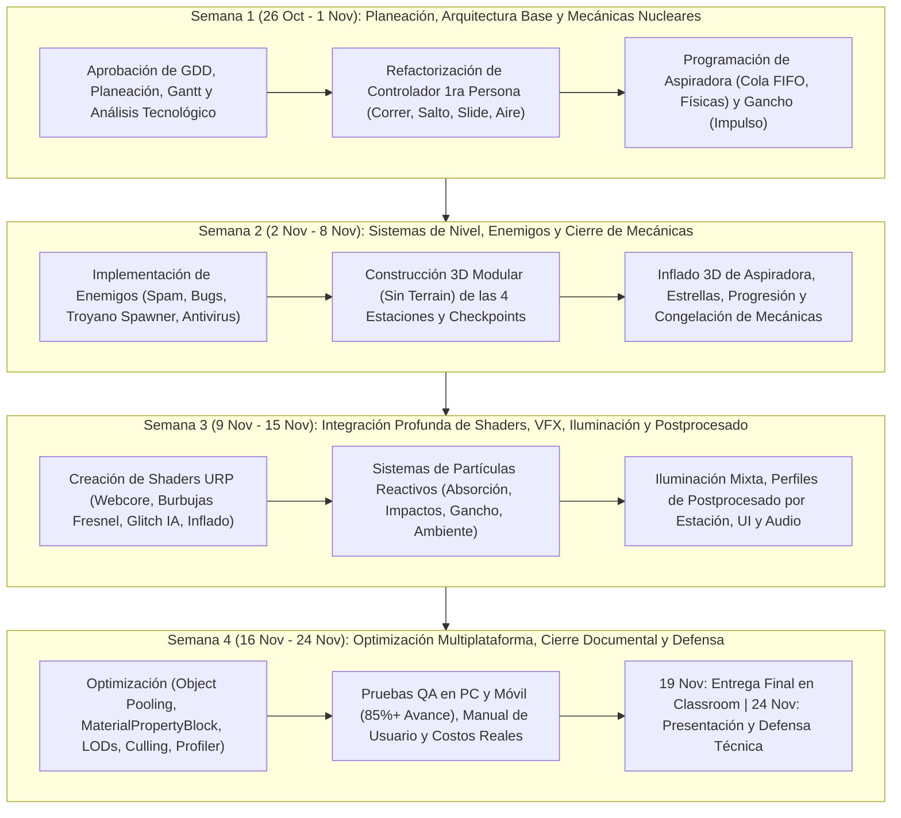

# Planeación de Ingeniería, Análisis Tecnológico, Cronograma y Viabilidad Financiera

**Proyecto:** *NostalgIA* (Prototipo Escalable de Videojuego 3D en Primera Persona)  
**Asignatura:** Fundamentos Técnicos de VFX  
**Docente:** Ing. Carlos Aldair Roman Balbuena  
**Fecha de Entrega en Classroom:** 19 de noviembre de 2026  
**Fecha de Presentación Final:** 24 de noviembre de 2026  

---

## 1. Objetivo del Proyecto

Desarrollar un prototipo funcional, optimizado y escalable del videojuego 3D en primera persona ***NostalgIA*** utilizando **Unity 6.3.7f1** bajo el **Universal Render Pipeline (URP)**. El prototipo tiene como propósito demostrar el dominio e integración de los seis pilares del arte técnico y efectos visuales en tiempo real: **shaders personalizados**, **sistemas de partículas reactivos**, **iluminación técnica mixta**, **postprocesado atmosférico justificado**, **optimización de renderizado multiplataforma (PC y dispositivos móviles)** y **sincronización sistémica mediante eventos y código C#**.

---

## 2. Alcance del Proyecto

El alcance del prototipo abarca el diseño, implementación técnica, integración de VFX y optimización de los siguientes módulos:

1. **Controlador en Primera Persona y Físicas de Movimiento:**
   * Desplazamiento con control aéreo, salto, carrera, agachado y deslizamiento (*slide*) con conservación de inercia.
   * Esquema de control multiplataforma unificado mediante *Unity Input System* con soporte para Teclado/Mouse (PC), Controles Táctiles en pantalla (Móvil) y Mando de Xbox en ambas plataformas.
2. **Herramientas Principales e Interacción Física con VFX:**
   * **Aspiradora Lanzadora:** Sistema de absorción por vórtice físico, almacenamiento interno en cola FIFO, deformación visual progresiva de la malla 3D de la herramienta (inflado según capacidad ocupada) y disparo de proyectiles físicos con partículas de salida e impacto.
   * **Gancho de Movilidad:** Detección de superficies compatibles por *Raycast/SphereCast*, tracción física con control aéreo, cancelación con conservación de *momentum*, enfriamiento por retracción del ducto y efectos visuales de tensión y anclaje.
3. **Sistemas de Juego, Enemigos y Progresión:**
   * Sistema de vida por corazones, peligros de muerte instantánea (*instakill*) y reaparición por *checkpoints*.
   * Implementación de las 4 variantes de amenazas digitales: *Correo de Spam* (proyectiles), *Bugs* (enjambre terrestre), *Troyano* (generador/*spawner* de *Bugs*) y *Antivirus* (obstáculo letal de impacto).
   * Sistema de recolección de estrellas (3 por nivel para "platinar" la estación) y mejoras permanentes de herramientas entre estaciones (alcance del gancho y capacidad de la aspiradora).
4. **Diseño de las 4 Estaciones y Dirección de Arte Técnico:**
   * **Estación 1 (Primavera — Webcore):** Nivel tutorial cerrado con shaders de desplazamiento de código y estética retro digital.
   * **Estación 2 (Verano — Frutiger Aero):** Nivel abierto construido íntegramente con mallas 3D modulares y *low poly* (sin uso de `Terrain`), shaders de burbujas iridiscentes (*Fresnel* + *Vertex Displacement*) e iluminación soleada de alto contraste.
   * **Estación 3 (Otoño — Dreamcore / Liminal):** Nivel de dificultad media-alta con niebla densa, iluminación fría y arquitectura surrealista.
   * **Estación 4 (Invierno — Motherboard Corrupta / IA):** Nivel final cerrado en el interior de una placa base con shaders de corrupción/glitch, monitores reactivos y postprocesado de distorsión digital.
5. **Interfaz de Usuario (HUD y Menús) y Audio:**
   * Flujo completo: Menú Principal $\rightarrow$ Selección de Estación $\rightarrow$ HUD de Partida (adaptado a PC y táctil con criterios de accesibilidad iconográfica) $\rightarrow$ Meta $\rightarrow$ Pantalla de Resultados.
   * Integración de audio ambiental por estación y efectos de sonido sincronizados con las herramientas, impactos y enemigos.

---

## 3. Limitantes y Restricciones Técnicas

En esta sección se establecieron las limitantes técnicas, académicas y operativas que rigen las decisiones de ingeniería del equipo:

1. **Prohibición Estricta de `Unity Terrain`:** Por reglamento de la asignatura y por optimización de *draw calls* y memoria en dispositivos móviles, no se emplea el sistema de terrenos nativo de Unity. Toda la topografía (incluyendo las colinas de la *Estación 2: Verano*) se construye con geometría poligonal 3D modelada y optimizada.
2. **Autoría y Modificación de Assets:** Todo modelo 3D, textura o recurso empleado es creado por el equipo o modificado de forma sustancial (en topología, mapeo UV, texturizado o aplicación de shaders personalizados) para ajustarse a la estética de collage Y2K de *NostalgIA*, manteniendo el registro de atribución correspondiente.
3. **Presupuesto de Hardware en Dispositivos Móviles:** Al tener los dispositivos móviles como plataforma objetivo junto con PC, se descartan técnicas de alto costo en GPU móvil (como *Raytracing*, sombras dinámicas en múltiples luces puntuales simultáneas o shaders con ramificaciones condicionales pesadas).
4. **Congelación de Mecánicas en la Semana 3:** El calendario limita la programación de nuevas mecánicas a las primeras dos semanas y media, destinando la fase final exclusivamente al pulido de VFX, iluminación, optimización y pruebas de rendimiento.

---

## 4. Requerimientos Técnicos de los Dispositivos de Visualización

Para garantizar una tasa de cuadros por segundo estable (60 FPS objetivo en PC y 30–60 FPS en dispositivos móviles), se definieron los siguientes perfiles de hardware:

### 4.1. Perfil en PC (Escritorio / Laptop)
| Componente | Requerimiento Mínimo | Requerimiento Recomendado |
| :--- | :--- | :--- |
| **Sistema Operativo** | Windows 10 (64-bit) / macOS 13+ | Windows 11 (64-bit) / macOS 14+ |
| **Procesador (CPU)** | Intel Core i5-8400 / AMD Ryzen 3 3100 o Apple M1 | Intel Core i7-10700K / AMD Ryzen 5 5600X o Apple M2/M3 |
| **Memoria RAM** | 8 GB RAM | 16 GB RAM |
| **Tarjeta Gráfica (GPU)** | NVIDIA GTX 1050 Ti / AMD RX 560 / GPU integrada Apple Silicon (Soporte DirectX 11 / Metal / Vulkan) | NVIDIA RTX 2060 / AMD RX 6600 o superior |
| **Almacenamiento** | 2 GB de espacio disponible | 2 GB en unidad SSD |
| **Periféricos** | Teclado y Mouse o Mando de Xbox | Teclado y Mouse o Mando de Xbox |

### 4.2. Perfil en Dispositivos Móviles (Celulares y Tabletas)
| Componente | Requerimiento Mínimo (Celular Gama Media) | Requerimiento Recomendado (Celular Gama Alta / Tableta) |
| :--- | :--- | :--- |
| **Sistema Operativo** | Android 10.0+ (API 29) / iOS 15+ | Android 13.0+ / iOS 17+ / iPadOS 17+ |
| **SoC / Procesador** | Snapdragon 720G / MediaTek Helio G95 / Apple A13 Bionic | Snapdragon 8 Gen 1+ / Apple A15 Bionic o Serie M (iPad) |
| **GPU Móvil** | Adreno 618 / Mali-G76 (Soporte OpenGL ES 3.2 / Vulkan / Metal) | Adreno 730+ / Apple GPU de 5 núcleos |
| **Memoria RAM** | 4 GB LPDDR4X | 6 GB – 8 GB LPDDR5 |
| **Resolución y Pantalla** | Pantalla táctil 1080p a 60 Hz | Pantalla táctil 1080p/1440p con soporte opcional de Mando Bluetooth Xbox |

---

## 5. Metodología de Desarrollo de Software

Para el desarrollo de *NostalgIA* en un equipo de dos integrantes y bajo un horizonte intensivo de 4 semanas, se optó por la metodología ágil **Scrum Adaptado a Videojuegos (Iterative Game Development con Sprints Semanales)** combinada con entrega por **Vertical Slices**:

1. **Sprints Semanales con Entregables Verificables:** Cada semana constituye un *Sprint* cerrado que culmina en una compilación funcional (*build*), una revisión de métricas de rendimiento en el *Profiler* de Unity y su respectiva evidencia documental para las entregas semanales del curso.
2. **Regla de Congelación de Código (*Feature Freeze*):** Alineada con los requerimientos de la materia, el *Sprint 1* y *Sprint 2* completan el 100% de la arquitectura C#, mecánicas de herramientas, enemigos y bloqueo 3D de las 4 Estaciones; a partir del *Sprint 3*, el desarrollo se enfoca estrictamente en la integración de Shaders, sistemas de partículas, iluminación, postprocesado y optimización.
3. **Control de Versiones en GitHub (Trunk-Based / Feature Branches):** Uso de ramas descriptivas (`feature/movement`, `feature/vfx-shaders`, `fix/mobile-optimization`) y mensajes de *commit* estructurados que documentan la evolución técnica del repositorio.

---

## 6. Diagrama de Gantt y Plan de Entregas Semanales

El cronograma cubre desde el inicio de la fase final de integración técnica (Semana 1: 26 de octubre de 2026) hasta la entrega oficial en Classroom (19 de noviembre de 2026) y la defensa del proyecto (24 de noviembre de 2026).

### Tabla Detallada del Cronograma Semanal (Diagrama de Gantt Tabular)

| Fase / Actividad Técnica | Responsable | Sem 1 (26 Oct–1 Nov) | Sem 2 (2–8 Nov) | Sem 3 (9–15 Nov) | Sem 4 (16–24 Nov) | Entregable de Avance Semanal |
| :--- | :---: | :---: | :---: | :---: | :---: | :--- |
| **1.1.** Documentación inicial: GDD, Planeación, Gantt y Costos Preliminares | Equipo (Ambos) | `████████` | | | | **Avance Sem. 1:** Documentación base aprobada + Prototipo de movimiento y herramientas en escena de pruebas. |
| **1.2.** Arquitectura C#, Input System (PC/Móvil/Xbox) y Movimiento (Slide/Aire) | Integrante 1 | `████████` | | | | |
| **1.3.** Lógica física de Aspiradora Lanzadora (FIFO) y Gancho con inercia | Integrante 2 | `████████` | | | | |
| **2.1.** IA y lógica de Enemigos (Spam, Bugs, Troyano, Antivirus) + Vida/Respawn | Integrante 1 | | `████████` | | | **Avance Sem. 2 (Feature Freeze):** Las 4 Estaciones transitables de inicio a meta con enemigos, estrellas y mejoras funcionando. |
| **2.2.** Modelado modular 3D (0% Terrain) y montaje de las 4 Estaciones | Integrante 2 | | `████████` | | | |
| **2.3.** Sistema de Estrellas, Progresión de Herramientas, HUD y Menús | Equipo (Ambos) | | `████████` | | | |
| **3.1.** Desarrollo de Shaders personalizados (HLSL / Shader Graph en URP) | Integrante 2 | | | `████████` | | **Avance Sem. 3:** Los 6 requerimientos técnicos de VFX integrados (Shaders, Partículas, Iluminación, Postprocesado y Audio). |
| **3.2.** Sistemas de Partículas reactivos a eventos de herramientas y entorno | Integrante 1 | | | `████████` | | |
| **3.3.** Iluminación Mixta (*Lightmapping*), *URP Volumes* por Estación y Audio | Equipo (Ambos) | | | `████████` | | |
| **4.1.** Optimización técnica: *Pooling*, `MaterialPropertyBlock`, *LODs* y *Culling* | Integrante 1 | | | | `█████░░░` | **Entrega Final (19 Nov):** Build PC + APK Móvil, Memorias Técnicas de VFX, Costos actualizados y Manual de Usuario. **Defensa: 24 Nov.** |
| **4.2.** Pruebas de rendimiento (PC/Móvil), Memoria Técnica VFX y Manual | Integrante 2 | | | | `█████░░░` | |
| **4.3.** Entrega en Classroom (19 Nov) y Presentación Final (24 Nov) | Equipo (Ambos) | | | | `░░░░████` | |

---

## 7. Análisis Completo de la Tecnología y Justificación de Uso

Para cumplir con las exigencias de rendimiento en dispositivos móviles sin sacrificar la riqueza visual de los efectos en PC, se realizó el siguiente análisis comparativo y justificación de la pila tecnológica seleccionada:

### 7.1. Motor Gráfico: Unity 6 (Versión 6.3.7f1)
* **Justificación técnica:** Se seleccionó **Unity 6.3.7f1** por su estabilidad en el ciclo de soporte extendido, las mejoras en el *GPU Resident Drawer* y la eficiencia del **SRP Batcher**, el cual reduce drásticamente el costo de configuración de estado en CPU (*SetPass calls*) cuando se renderizan múltiples objetos con distintos materiales que comparten un mismo shader personalizado. Asimismo, su sistema de compilación cruzada permite desplegar el mismo código base hacia ejecutables de escritorio (Windows/macOS) y paquetes móviles (Android APK / iOS) manteniendo un perfil de memoria controlado.

### 7.2. Pipeline de Renderizado: Universal Render Pipeline (URP) vs. Alternativas
Se evaluaron los tres pipelines disponibles en Unity antes de iniciar la producción:
1. **Built-in Render Pipeline (Descartado):** Carece de integración nativa moderna con *Shader Graph*, no aprovecha el *SRP Batcher* de manera óptima y su sistema de postprocesado (*Post-Processing Stack v2*) genera mayor sobrecarga de *overdraw* en GPUs móviles con arquitectura *Tile-Based Deferred Rendering (TBDR)*.
2. **High Definition Render Pipeline — HDRP (Descartado):** Orientado exclusivamente a consolas de última generación y PC de gama alta; resulta incompatible con el presupuesto térmico y de ancho de banda de memoria de dispositivos móviles.
3. **Universal Render Pipeline — URP (Seleccionado):**
   * **Renderizado Forward/Forward+ en una sola pasada (*Single-Pass Forward*):** Evalúa la luz direccional principal y las luces adicionales por objeto en una única pasada, minimizando el tráfico de memoria en chips móviles.
   * **Compatibilidad nativa con HLSL y Shader Graph:** Permite programar shaders personalizados altamente optimizados que cumplen el contrato del *SRP Batcher* (`CBUFFER_START(UnityPerMaterial)`).
   * **Sistema de Volúmenes (*URP Volume Framework*):** Permite interpolar suavemente perfiles de postprocesado (*Bloom*, *Color Adjustments*, *Vignette*, *Chromatic Aberration*) entre las 4 Estaciones con un costo computacional predecible.

### 7.3. Sub-sistemas Técnicos Clave
* **Unity Input System (Paquete moderno):** Se eligió en lugar del antiguo `Input Manager` porque permite mapear una misma Acción Lógica (ej. `Absorber`, `UsarGancho`, `Deslizarse`) simultáneamente a Teclado/Mouse, Gamepad de Xbox y botones táctiles en pantalla (`On-Screen Stick` / `On-Screen Button`) sin duplicar la lógica del controlador.
* **Sistema de Partículas (*Shuriken Particle System*) con Eventos de C#:** Se optó por el sistema de partículas en CPU/GPU instanciado mediante *Object Pooling* y controlado por scripts, garantizando compatibilidad universal con el 100% de dispositivos móviles OpenGL ES 3.2 / Vulkan / Metal (donde *VFX Graph* basado en Compute Shaders puede presentar limitaciones en gamas medias).

---

## 8. Análisis de Costos, Viabilidad y Determinación del Precio

Con base en los requerimientos del curso, se presenta el análisis económico detallado del desarrollo del prototipo (considerando una duración de desarrollo efectivo de **1 mes / 4 semanas** por un equipo de **2 desarrolladores con perfil de Programador / Technical Artist**) y su proyección de viabilidad comercial en el mercado independiente.

### 8.1. Análisis de Costos Detallado (Presupuesto de Desarrollo)

Se calculan los costos reales y de oportunidad bajo estándares del mercado de desarrollo de software y videojuegos en México (expresados en **Pesos Mexicanos — MXN**):

#### A. Costos de Mano de Obra (Capital Humano)
* Dedicación por integrante: **20 horas semanales** $\times$ 4 semanas = **80 horas por integrante** (**160 horas hombre totales** del equipo).
* Tarifa base de mercado para *Desarrollador Unity Jr. / Technical Artist Jr.*: **\$250.00 MXN / hora**.

| Rol en el Proyecto | Horas Totales | Tarifa por Hora (MXN) | Subtotal (MXN) |
| :--- | :---: | :---: | :---: |
| **Desarrollador 1:** Ingeniería de Gameplay, Físicas, IA de Enemigos y Optimización | 80 hrs | \$250.00 | \$20,000.00 |
| **Desarrollador 2:** Technical Artist (Shaders, VFX, Iluminación, Modelado 3D y UI) | 80 hrs | \$250.00 | \$20,000.00 |
| **Subtotal Mano de Obra** | **160 hrs** | — | **\$40,000.00 MXN** |

#### B. Costos de Licencias de Software y Servicios
| Herramienta / Licencia | Tipo de Licencia | Costo Mensual Aplicado (MXN) |
| :--- | :--- | :---: |
| **Unity 6.3.7f1 Personal** | Gratuita (Ingresos anuales < \$200,000 USD) | \$0.00 |
| **Blender 4.x (Modelado 3D y modificación de mallas)** | Open Source (GPL) | \$0.00 |
| **GitHub (Control de versiones y repositorio remoto)** | Plan Free / Student Developer Pack | \$0.00 |
| **IDE de Desarrollo (JetBrains Rider / VS Code)** | Licencia académica / gratuita | \$0.00 |
| **Cuota de Registro de Tienda (Steam Direct / Google Play Console)** | Reserva prorrateada para publicación comercial (Google Play: \$25 USD pago único $\approx$ \$500 MXN) | \$500.00 |
| **Subtotal Software y Licencias** | — | **\$500.00 MXN** |

#### C. Costos Operativos, Depreciación de Hardware e Imprevistos
* **Amortización de Equipos de Cómputo y Dispositivos de Prueba (2 PCs + 1 móvil durante 1 mes):** \$1,800.00 MXN.
* **Servicios (Energía eléctrica e Internet de banda ancha proporcional al mes de desarrollo):** \$700.00 MXN.
* **Fondo de Contingencia / Imprevistos Técnicos (5% sobre costos directos):** \$2,150.00 MXN.

#### Resumen del Costo Total del Proyecto
| Categoría de Costo | Monto (MXN) | % del Presupuesto |
| :--- | :---: | :---: |
| 1. Mano de Obra Especializada (160 hrs) | \$40,000.00 | 88.6% |
| 2. Licencias y Registro de Distribución | \$500.00 | 1.1% |
| 3. Hardware (Amortización) y Servicios Operativos | \$2,500.00 | 5.5% |
| 4. Contingencia (5%) | \$2,150.00 | 4.8% |
| **COSTO TOTAL DE INVERSIÓN DEL PROYECTO** | **\$45,150.00 MXN** | **100%** |

---

### 8.2. Determinación del Precio de Venta

Dado que el público objetivo de *NostalgIA* está conformado por adultos jóvenes (20–35 años) con poder adquisitivo afines a propuestas indie experimentales (como *ENA*, *Neon White* o *Portal*), se establece un modelo de **venta directa (*Premium Indie*) en PC (Steam / Itch.io)** y **versión completa desbloqueable en Dispositivos Móviles (Google Play / App Store)**:

* **Precio de Venta al Público (PVP) determinado:** **\$99.00 MXN** (equivalente a **\$4.99 USD** internacional).
* **Retención promedio de plataformas digitales (Steam / Google Play / Impuestos):** **30%** (\$29.70 MXN).
* **Ingreso Neto por Unidad Vendida para el Equipo:**
  $$\text{Ingreso Neto Unitario} = \$99.00 \times (1 - 0.30) = \$69.30\text{ MXN}$$

---

### 8.3. Análisis de Viabilidad Técnica y Económica (Punto de Equilibrio y ROI)

#### 1. Viabilidad Técnica
El proyecto es **altamente viable a nivel técnico** debido a tres decisiones arquitectónicas clave:
* La estética de collage Y2K (*Webcore* / *Frutiger Aero* / *Low Poly*) convierte las geometrías simplificadas y texturas retro en una virtud artística, permitiendo que los recursos de GPU se concentren en los **Shaders personalizados** y **Sistemas de Partículas**.
* La arquitectura modular permite escalar el juego agregando nuevas Estaciones o desafíos sin reescribir el controlador de primera persona ni la lógica de las herramientas.
* El uso de **URP en Unity 6.3.7f1** asegura compatibilidad simultánea con PC y dispositivos móviles desde un único proyecto.

#### 2. Viabilidad Económica y Punto de Equilibrio (*Break-Even Point*)
Para recuperar el 100% de la inversión total de desarrollo (**\$45,150.00 MXN**):

$$\text{Punto de Equilibrio (Unidades)} = \frac{\text{Costo Total del Proyecto}}{\text{Ingreso Neto Unitario}} = \frac{\$45,150.00}{\$69.30} \approx \mathbf{652\text{ copias vendidas}}$$

* **Evaluación de Escenarios Financieros (Proyección a 6 meses tras el lanzamiento):**
  * **Escenario Conservador (700 copias entre PC y Móvil):** Ingreso neto de **\$48,510.00 MXN** $\rightarrow$ Recuperación total de la inversión + **7.4% de utilidad neta**.
  * **Escenario Moderado / Esperado (1,500 copias):** Ingreso neto de **\$103,950.00 MXN** $\rightarrow$ Utilidad neta de **\$58,800.00 MXN** (**ROI del 130.2%**).
  * **Escenario Optimista (3,500 copias impulsadas por nicho estético Webcore/Frutiger Aero en redes):** Ingreso neto de **\$242,550.00 MXN** $\rightarrow$ Utilidad neta de **\$197,400.00 MXN** (**ROI del 437.2%**).

**Conclusión de Viabilidad:** Al requerir únicamente **652 unidades vendidas** para alcanzar el punto de equilibrio y contar con costos fijos de licencias prácticamente nulos, el proyecto es técnica y financieramente viable y escalable.
