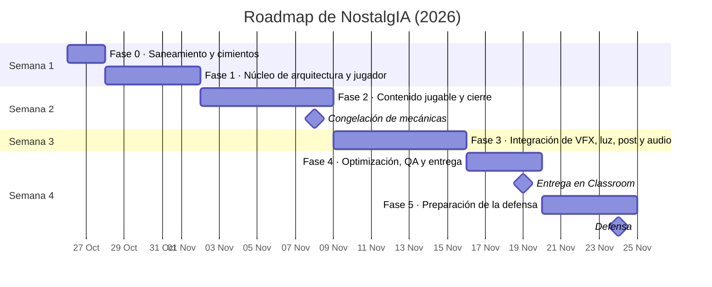

# Roadmap de Desarrollo por Fases — *NostalgIA*

**Proyecto:** *NostalgIA* — Fundamentos Técnicos de VFX  
**Periodo:** 26 de octubre al 24 de noviembre de 2026  
**Entrega en Classroom:** 19 de noviembre de 2026 · **Defensa:** 24 de noviembre de 2026  
**Versión del documento:** 1.0 — 26 de octubre de 2026  
**Documentos relacionados:** `Docs/TDD_Arquitectura.md`, `Docs/GDD.md`, `Docs/Requisitos.md`, `Docs/Planeacion_Costos_y_Gantt.md`

---

## 1. Propósito

Este roadmap divide el desarrollo restante en seis fases secuenciales alineadas con las cuatro semanas del cronograma de `Docs/Planeacion_Costos_y_Gantt.md`. Cada fase define su objetivo, sus tareas en dos pistas de trabajo paralelas y los criterios que deben cumplirse para darla por cerrada.

La regla de congelación de mecánicas de `Docs/Requisitos.md` se aplica de forma estricta: **el 8 de noviembre a las 23:59 se cierra la última mecánica de juego**. Desde el 9 de noviembre solo se integran recursos visuales, VFX, shaders, iluminación, postprocesado, audio y optimización, y se corrigen errores.

### 1.1. Pistas de trabajo

| Pista | Contenido | Responsable principal |
| :--- | :--- | :--- |
| **A — Ingeniería C# y escena** | Código, arquitectura, configuración del proyecto, montaje lógico de escenas, pruebas automatizadas y de rendimiento | Integrante 1 (con apoyo del Integrante 2 en herramientas durante la Fase 1) |
| **B — Arte técnico, niveles, UI y documentación** | Shaders, partículas, iluminación, postprocesado, modelado y montaje visual de estaciones, animaciones, UI, audio y memorias técnicas en PDF | Integrante 2 (con apoyo del Integrante 1 en documentación) |

Cada tarea tiene un identificador `F<fase>-<pista><número>` (por ejemplo, `F1-A03`) que se cita en los mensajes de *commit* y en la bitácora técnica.

### 1.2. Punto de partida (26 de octubre)

| Área | Estado |
| :--- | :--- |
| Movimiento en primera persona | Funcional; entrada ligada a dispositivos concretos |
| Gancho | Funcional y completo en física |
| Aspiradora Lanzadora | Funcional; absorción por rayo único; inflado por escalado de huesos |
| Enemigos | Correo, Bugs, Troyano y Antivirus funcionales en versión de prototipo; modelos finales de Correo, Antivirus y Troyano |
| Estaciones | Tutorial (base de Primavera) con lava electrónica final; Verano, Otoño e Invierno sin construir |
| Menús, progresión, audio | Sin implementar |
| Pilares de VFX | Dos shaders HLSL propios; sin Volumes, partículas de eventos ni iluminación horneada |

### 1.3. Calendario de fases

---

## 2. Definición de terminado (aplica a toda tarea)

Una tarea se considera terminada cuando:

1. Compila sin advertencias nuevas en los ensamblados de `_Project`.
2. Funciona con los tres esquemas de entrada que le apliquen (teclado y ratón, mando de Xbox, táctil).
3. Todas sus clases y métodos públicos tienen comentario XML en español.
4. No introduce asignaciones de GC por frame en juego (verificado en el Profiler cuando la tarea toca el bucle de juego).
5. Está integrada en `testing` mediante *commit* con identificador de tarea y mensaje descriptivo.
6. Si produce evidencia para la rúbrica, la captura o métrica queda registrada en `Docs/Bitacora_Tecnica/`.

---

## 3. Fase 0 — Saneamiento y cimientos

**Fechas:** 26–27 de octubre · **Semana del Gantt:** 1  
**Objetivo:** dejar el repositorio y el proyecto en condiciones de recibir la nueva arquitectura sin romper lo que ya funciona.

### a) Tareas de Ingeniería C# y Escena (Pista A)

| ID | Tarea |
| :--- | :--- |
| F0-A01 | Versionar `Docs/` en git; agregar `.DS_Store`, `.idea/` y `.vscode/` a `.gitignore` y retirarlos del índice. |
| F0-A02 | Crear la estructura de carpetas de `Assets/_Project/` y `Assets/ThirdParty/` (TDD §14) moviendo assets desde el editor para conservar los GUID. |
| F0-A03 | Crear los ensamblados `NostalgIA.Core`, `NostalgIA.Input`, `NostalgIA.Gameplay`, `NostalgIA.Presentation` y `NostalgIA.Editor` con sus referencias (TDD §2.1). |
| F0-A04 | Implementar `ProjectValidator` con la comprobación de Terrain, scripts faltantes y material por defecto de ProBuilder, y conectarlo a `IPreprocessBuildWithReport` (TDD §15). |
| F0-A05 | Limpiar *Build Settings*: retirar `Prototype.unity` y la referencia inexistente `Aspiradora.unity`; crear `00_Boot.unity` como primera escena. |
| F0-A06 | Configurar *Player Settings*: nombre del producto `NostalgIA`, compañía del equipo, Android API mínima 29, orientación horizontal fija, identificador de paquete. |
| F0-A07 | Renombrar las capas `Poolable` → `Absorbable` y `Graple` → `Grapple` conservando sus índices; agregar `Enemy`, `Hazard`, `PlayerProjectile`, `EnemyProjectile`, `Debris` y `Trigger`; podar la matriz de colisiones (TDD §13). |
| F0-A08 | Etiqueta de respaldo `v0.1-prototipo` sobre el estado actual antes de la refactorización. |

### b) Tareas Visuales, Shaders, VFX, Niveles, UI y Documentación (Pista B)

| ID | Tarea |
| :--- | :--- |
| F0-B01 | Retirar `TutorialInfo/`, `Readme.asset`, la escena y materiales de demostración del controlador externo y, si no se va a modificar, `Customizable Skybox/`. |
| F0-B02 | Crear `CREDITS.md` con el registro de assets externos, su licencia y la modificación realizada; incluir los modelos finales del equipo. |
| F0-B03 | Verificar referencias cruzadas en `Docs/` y crear los esqueletos de `Docs/Manual_de_Usuario.md` y de la bitácora semanal. |
| F0-B04 | Definir la guía de estilo por estación (paleta, iluminación clave, referencias) a partir del GDD §4.2 y §6, como base de la Fase 3. |

### c) Criterios de aceptación y pruebas

- El proyecto abre y el Tutorial se juega igual que en `v0.1-prototipo` (prueba de regresión manual: recorrido completo de inicio a portal).
- `NostalgIA/Validar proyecto` se ejecuta sin errores; el reporte confirma **0 componentes Terrain**.
- La compilación de un cambio en `Gameplay` no recompila `Presentation` (verificable en la consola del editor).
- `git status` limpio tras clonar en otra máquina; `Docs/` presente en el repositorio remoto.

---

## 4. Fase 1 — Núcleo de arquitectura y mecánicas del jugador

**Fechas:** 28 de octubre – 1 de noviembre · **Semana del Gantt:** 1  
**Objetivo:** reemplazar los cimientos del prototipo por la arquitectura del TDD: entrada única, bus de eventos, motor del jugador, herramientas, vida, reaparición y *pooling*.  
**Entrega semanal 1:** documentación base aprobada y prototipo de movimiento y herramientas jugable con teclado y ratón, mando de Xbox y pantalla táctil.

### a) Tareas de Ingeniería C# y Escena (Pista A)

| ID | Tarea | Referencia TDD |
| :--- | :--- | :--- |
| F1-A01 | Implementar `EventBus<T>`, el catálogo de eventos y el `ServiceLocator` mínimo de `Core`. | §4 |
| F1-A02 | Reestructurar el asset de acciones en mapas `Gameplay` y `UI` con las acciones y *bindings* del GDD; generar la clase C#. | §7.1 |
| F1-A03 | Implementar `InputReader` (suma de `LookDelta` y `LookStick`, eventos de pulsación, activación de mapas, reasignación persistente). | §7.2 |
| F1-A04 | Implementar `InputSchemeResolver` y publicar `InputSchemeChanged`. | §7.4 |
| F1-A05 | Implementar controles táctiles: `DynamicTouchStick`, `TouchLookZone`, `TouchToolPad` y botones; lienzo con `SafeAreaFitter`. | §7.5 |
| F1-A06 | Trasladar el controlador derivado a `PlayerMotor` con estado `Grappling` integrado; conservación de impulso aéreo; deslizamiento desde `Crouch` en los tres esquemas; desactivar nado y cornisa; publicar eventos de locomoción. | §5.1 |
| F1-A07 | Implementar `AimService` con un único `Raycast` por frame y `AimTargetChanged`. | §6.2 |
| F1-A08 | Implementar `ToolController` e `ITool`, resolución contextual de acciones y enfriamiento compartido. | §6.1, §7.3 |
| F1-A09 | Implementar `VacuumTool` con detección en cono (`OverlapSphereNonAlloc` + ángulo + línea de visión), `VacuumStorage` FIFO y disparo con verificación de salida; migrar `PoolableController` a `Absorbable`. | §6.3 |
| F1-A10 | Implementar `GrappleTool` con la física existente parametrizada en `GrappleStats`. | §6.4 |
| F1-A11 | Implementar `PlayerHealth` con `DamageInfo`, invulnerabilidad e *instakill*; `KillVolume`. | §5.2 |
| F1-A12 | Implementar `RespawnService`, `Checkpoint` e `IResettable`; retirar la recarga de escena y las coordenadas fijas del controlador actual. | §5.3 |
| F1-A13 | Implementar `PoolService`, `PoolDefinition`, `PooledObject` e `IPoolable`. | §8.5.1 |
| F1-A14 | Implementar `GameStateMachine` con pausa, bloqueo de cursor y escala de tiempo; prefab persistente `GameRoot` en `00_Boot`. | §3.2 |
| F1-A15 | Crear los `ScriptableObject` `PlayerSettings`, `VacuumStats` y `GrappleStats` con los valores actuales del prototipo. | §10 |
| F1-A16 | Montar en el Tutorial los nuevos componentes y retirar el controlador monolítico, `TutorialZonePrompt` y los ajustes de escena por código. | §9.2 |

### b) Tareas Visuales, Shaders, VFX, Niveles, UI y Documentación (Pista B)

| ID | Tarea |
| :--- | :--- |
| F1-B01 | Diseñar el kit modular de Primavera y Verano (pisos, muros, columnas, plataformas, colinas *low poly*) como mallas ProBuilder/Blender, sin Terrain. |
| F1-B02 | Crear la biblioteca de materiales base por estación y reemplazar el material por defecto de ProBuilder en el Tutorial. |
| F1-B03 | Diseñar los iconos de controles táctiles, la retícula con sus cuatro estados y los glifos por esquema (`InputGlyphSet`). |
| F1-B04 | Definir el `AnimatorController` de la herramienta (capas Base y Garras) y producir los primeros clips: inactivo, aspirar, disparar, disparo del gancho y transición de modo. |
| F1-B05 | Crear `NostalgIA_Common.hlsl` (*hash*, ruido de valor, paleta coseno, Fresnel, Bayer 4×4) como base de los shaders de la Fase 3. |
| F1-B06 | Redactar la entrega semanal 1 y la primera entrada de la bitácora técnica (decisiones de arquitectura y diagrama de capas). |

### c) Criterios de aceptación y pruebas de rendimiento

**Funcionales:**

- Con teclado y ratón, mando de Xbox y pantalla táctil se pueden ejecutar todas las acciones de la tabla de controles del GDD sin reiniciar el juego.
- Conectar o desconectar un mando durante la partida no interrumpe el teclado ni el ratón, y los controles táctiles se ocultan al usar un mando en móvil.
- La aspiradora absorbe varios objetos en un barrido de cámara, respeta la capacidad, y el primer objeto absorbido es el primero en dispararse.
- El gancho engancha solo superficies `Grapple`; cancelarlo conserva el impulso; durante el enfriamiento ninguna herramienta responde.
- Un salto tras deslizarse conserva la velocidad horizontal.
- Morir reubica al jugador en el último checkpoint en menos de 1 s sin recargar la escena.
- Ningún script de `Gameplay` referencia a `Presentation` (lo garantiza el ensamblado).

**Rendimiento (Tutorial, PC de desarrollo y Android de prueba):**

| Prueba | Meta |
| :--- | :--- |
| GC por frame durante 60 s de juego con uso continuo de herramientas | 0 B |
| Llamadas a `Physics.RaycastAll` en el Profiler | 0 |
| Tiempo de reaparición (de `PlayerDied` a `PlayerRespawned`) | ≤ 1 s |
| FPS del Tutorial en Android de prueba (referencia para fases siguientes) | Registrado en bitácora |

---

## 5. Fase 2 — Contenido jugable y congelación de mecánicas

**Fechas:** 2–8 de noviembre · **Semana del Gantt:** 2  
**Objetivo:** completar todas las mecánicas del GDD y dejar las cuatro estaciones jugables de inicio a meta.  
**Hito:** **congelación de mecánicas el 8 de noviembre, 23:59.**  
**Entrega semanal 2:** las cuatro estaciones transitables con enemigos, estrellas, mejoras, menús y audio provisional.

> **Alcance de las estaciones.** Para cumplir el hito, Verano, Otoño e Invierno se construyen como segmentos de 3 a 5 minutos de recorrido con el kit modular, cada uno con 3 estrellas, al menos 2 checkpoints y una puerta de meta. Primavera conserva y reorganiza el recorrido del Tutorial.

### a) Tareas de Ingeniería C# y Escena (Pista A)

| ID | Tarea | Referencia TDD |
| :--- | :--- | :--- |
| F2-A01 | Implementar `EnemyBase`, `EnemyBrain`, `PerceptionSensor` y `ImpactDamageResolver` (algoritmo F = m·a actual). | §9.1 |
| F2-A02 | Migrar el Correo de Spam a la nueva base con proyectiles desde el *pool*. | §9.1 |
| F2-A03 | Migrar Bugs a la nueva base, en *pool*. | §9.1 |
| F2-A04 | Implementar el Troyano: disfrazado → revelación por detección → oleadas de Bugs desde el *pool* con límite de activos. | §9.1 |
| F2-A05 | Implementar el Antivirus tipo *Thwomp*: espera, aviso, caída con `BoxCast`, *instakill* y ascenso. | §9.1 |
| F2-A06 | Crear `EnemyData` y sus subtipos; eliminar los cuatro prefabs de prototipo duplicados. | §10 |
| F2-A07 | Implementar `StationController`, `Star`, `GoalDoor`, `TutorialDirector` y `StationData`. | §9.2 |
| F2-A08 | Implementar `ProgressionService`, `UpgradeData` y `SaveService` (JSON); aplicar mejoras de alcance del gancho y capacidad de la aspiradora. | §9.3 |
| F2-A09 | Implementar `SceneLoader` asíncrono con pantalla de carga y precalentamiento de *pools*. | §3.1, §8.5.1 |
| F2-A10 | Implementar la lógica de menús: principal, selección de estación, pausa, opciones (sensibilidad, reasignación, calidad, volumen) y resultados (completado / platinado). | §12 |
| F2-A11 | Implementar `HUDPresenter` dirigido por eventos y sin asignaciones. | §12 |
| F2-A12 | Implementar `AudioManager`, `AudioMixer`, `SfxCue` y `AudioEventRouter` con sonidos provisionales en todos los eventos. | §11 |
| F2-A13 | Montar la lógica de las cuatro estaciones (checkpoints, estrellas, enemigos, peligros, meta) sobre la geometría de la Pista B. | §9.2 |
| F2-A14 | Escribir pruebas de modo de edición para `VacuumStorage`, `ImpactDamageResolver`, `SaveService` y `ProgressionService`. | — |
| F2-A15 | Revisión de cierre de mecánicas: lista de verificación contra el GDD y etiqueta `v0.5-feature-freeze`. | — |

### b) Tareas Visuales, Shaders, VFX, Niveles, UI y Documentación (Pista B)

| ID | Tarea |
| :--- | :--- |
| F2-B01 | Construir la geometría de Verano (colinas *low poly* como mallas, agua, plataformas aéreas) con el kit modular. |
| F2-B02 | Construir la geometría de Otoño (pasillos liminales, pisos de damero, bustos con pantallas). |
| F2-B03 | Construir la geometría de Invierno (laberinto de placa base, torres de monitores CRT). |
| F2-B04 | Modelar el Bug (insecto robótico translúcido inspirado en HEXBUG) con presupuesto de 1 500 triángulos y su LOD1. |
| F2-B05 | Producir las animaciones de los modelos finales: Correo (aleteo, carga, disparo), Troyano (inactivo, revelación, apertura de compuerta), Antivirus (espera, aviso, caída, ascenso) y Bug (caminar, salto); `AnimatorController` de cada uno. |
| F2-B06 | Diseñar y montar las pantallas de UI: HUD según GDD §5.1, menú principal, selección de estación, pausa, opciones, resultados y pantalla de carga. |
| F2-B07 | Seleccionar o producir audio provisional y final (ambientes por estación, música, efectos) y registrar licencias en `CREDITS.md`. |
| F2-B08 | Redactar la entrega semanal 2 y actualizar `Docs/Manual_de_Usuario.md` con controles por plataforma y objetivos por estación. |

### c) Criterios de aceptación y pruebas de rendimiento

**Funcionales (bloqueantes para la congelación):**

- Cada estación se completa de inicio a meta con los tres esquemas de entrada, en PC y en Android.
- Cada estación tiene 3 estrellas alcanzables; recoger las 3 muestra el estado "platinado" en resultados.
- Completar una estación aplica su mejora y esta se refleja en el comportamiento y en la escala visual de la herramienta.
- Los cuatro enemigos se comportan como describe el GDD §3.3; la aspiradora no absorbe enemigos y el gancho no se engancha a ellos.
- El progreso persiste al cerrar y reabrir el juego.
- Todo evento del catálogo tiene al menos un sonido provisional.
- `ProjectValidator` sin errores en las cuatro estaciones.
- Las pruebas de modo de edición pasan.

**Rendimiento (antes del pulido visual, como línea base):**

| Prueba | PC de prueba | Android de prueba |
| :--- | :-: | :-: |
| Escenario de combate: Troyano con 8 Bugs + 3 Correos activos | ≥ 60 FPS | ≥ 30 FPS |
| GC por frame en el escenario de combate | 0 B | 0 B |
| Carga de cualquier estación | ≤ 5 s | ≤ 10 s |

Las mediciones se registran en `Docs/Bitacora_Tecnica/` como línea base para comparar en la Fase 4.

---

## 6. Fase 3 — Integración de VFX, iluminación, postprocesado y audio

**Fechas:** 9–15 de noviembre · **Semana del Gantt:** 3  
**Restricción:** mecánicas congeladas. Solo se escribe código de presentación (drivers visuales, de audio y de postprocesado) y corrección de errores.  
**Objetivo:** implementar los seis pilares técnicos de VFX completos.  
**Entrega semanal 3:** los seis requisitos técnicos integrados y visibles en las cuatro estaciones.

### a) Tareas de Ingeniería C# y Escena (Pista A)

| ID | Tarea | Referencia TDD |
| :--- | :--- | :--- |
| F3-A01 | Implementar `VfxSpawner` y los oyentes de eventos que solicitan efectos al `PoolService`. | §8.2 |
| F3-A02 | Implementar `VacuumVisualDriver` (`_Fill01`, `_SwallowPhase`, `_DeflatePulse` por `MaterialPropertyBlock`) y retirar el escalado de huesos del depósito. | §6.5 |
| F3-A03 | Implementar drivers de shader: propiedades globales (`_NOS_Corruption`, pulso de daño, tiempo de escaneo) y `MaterialPropertyBlock` para disolución y destello de enemigos. | §8.1.2 |
| F3-A04 | Implementar `PostFXController` con el Volume de retroalimentación y sus curvas por evento. | §8.4 |
| F3-A05 | Implementar `CameraFX` (sacudida direccional, retroceso, FOV) y los `AnimatorBridge` de herramienta y enemigos. | §8.6 |
| F3-A06 | Implementar `StationAtmosphere` (aplicación de `AtmosphereProfile`: Volume, niebla, ambiente, audio y partículas ambientales). | §8.3 |
| F3-A07 | Implementar `QualityService` y `QualityProfile` (PC / Móvil) con selección automática y opción manual. | §8.5.3 |
| F3-A08 | Ampliar `ProjectValidator` con la verificación de compatibilidad de SRP Batcher de los shaders propios. | §15 |
| F3-A09 | Script de editor para hornear iluminación y oclusión de las cuatro estaciones en lote. | §8.3 |

### b) Tareas Visuales, Shaders, VFX, Niveles, UI y Documentación (Pista B)

| ID | Tarea |
| :--- | :--- |
| F3-B01 | Shader `NOS/WebcoreScreen` (desplazamiento UV de código, pixelado en espacio de pantalla, *dithering* Bayer). |
| F3-B02 | Shader `NOS/AeroBubble` (Fresnel, iridiscencia por paleta coseno, desplazamiento senoidal de vértices, refracción en PC). |
| F3-B03 | Shader `NOS/GlitchCorruption` (desfase de vértices por bloques, separación RGB, escaneo) controlado por `_NOS_Corruption`. |
| F3-B04 | Shader `NOS/VacuumInflate` sobre el depósito del modelo final de la herramienta (`Bone.003` y `Bone.004`, máscara en espacio de objeto, onda peristáltica, emisión) y shader `NOS/ToolBeam` para ducto/cable de tensión (retirando `Resources/ToolRay.shader`). |
| F3-B05 | Shaders `NOS/DigitalDissolve` (aparición y muerte de enemigos), `NOS/LiminalChecker` (damero distorsionado de Otoño) y `NOS/RetroBillboard` (elementos 2D de collage Y2K en espacio 3D). |
| F3-B06 | Sistemas de partículas del catálogo (TDD §8.2): vórtice, destello, estela, impacto, anclaje, *speed lines*, enemigos, Antivirus, estrella, checkpoint y ambientes de las cuatro estaciones. |
| F3-B07 | Iluminación mixta por estación: `LightingSettings`, banderas estáticas, luces horneadas, *light probes*, *reflection probes* y horneado. |
| F3-B08 | Perfiles `VP_Primavera`, `VP_Verano`, `VP_Otono`, `VP_Invierno` y `VP_Feedback`, calibrados en PC y móvil. |
| F3-B09 | Mezcla de audio final por estación (niveles, instantáneas, ambiente). |
| F3-B10 | Iniciar las memorias técnicas en PDF (`Docs/Reportes_PDF/`): una sección por shader con fórmula, parámetros, capturas y costo; una por pilar. |
| F3-B11 | Redactar la entrega semanal 3 con capturas antes/después de cada pilar. |

### c) Criterios de aceptación y pruebas de rendimiento

**Funcionales y de evidencia por pilar:**

| Pilar | Criterio de aceptación |
| :--- | :--- |
| 3.1 Shaders | Ocho shaders propios integrados (siete con mejoras/nuevos más la lava electrónica final y el portal documentado); todos compatibles con SRP Batcher según el Frame Debugger; parámetros controlados desde C# donde el TDD lo indica. |
| 3.2 Partículas | Cada evento del catálogo produce su efecto; ningún efecto se crea con `Instantiate` durante el juego. |
| 3.3 Iluminación | Cuatro estaciones con lightmaps horneados, luces decorativas `Baked` y solo luces dinámicas de retroalimentación en `Realtime`. |
| 3.4 Postprocesado | Un perfil por estación con su justificación escrita; el Volume de retroalimentación reacciona a daño, ataque de la IA y velocidad. |
| 3.5 Optimización | Niveles de calidad PC y móvil aplicados automáticamente. |
| 3.6 Integración | Cada fila de la matriz evento → respuesta (TDD §8.6) verificada en juego. |

**Rendimiento (con todos los efectos activos):**

| Prueba | PC de prueba | Android de prueba |
| :--- | :-: | :-: |
| Recorrido completo de cada estación | ≥ 60 FPS | ≥ 30 FPS |
| *SetPass calls* en el punto más cargado | ≤ 300 | ≤ 120 |
| Partículas simultáneas máximas | ≤ 4 000 | ≤ 1 000 |
| GC por frame | 0 B | 0 B |

Si una estación no cumple en móvil, se ajusta su `QualityProfile` o su contenido visual antes de cerrar la fase; no se agregan mecánicas para compensar.

---

## 7. Fase 4 — Optimización, aseguramiento de calidad y entrega

**Fechas:** 16–19 de noviembre · **Semana del Gantt:** 4  
**Objetivo:** cumplir las metas de rendimiento con evidencia, cerrar errores y entregar en Classroom el 19 de noviembre.  
**Entregables:** build de PC, APK de Android, memorias técnicas en PDF, `Docs/Manual_de_Usuario.md`, análisis de costos actualizado y repositorio limpio.

### a) Tareas de Ingeniería C# y Escena (Pista A)

| ID | Tarea |
| :--- | :--- |
| F4-A01 | Perfilado en dispositivo (*Development Build*) de los cuatro escenarios de prueba (§9) con Profiler, Frame Debugger y Memory Profiler; corrección de picos. |
| F4-A02 | Ajuste de tamaños de *pool* con los máximos observados. |
| F4-A03 | Horneado final de *Occlusion Culling* en Primavera, Otoño e Invierno; ajuste del plano lejano por estación. |
| F4-A04 | Conversión a colisión estática de los objetos no interactivos; revisión de la matriz de colisiones. |
| F4-A05 | Builds de entrega: Windows (y macOS si hay equipo disponible) y Android (IL2CPP, ARM64, Vulkan + OpenGL ES 3); prueba de instalación limpia. |
| F4-A06 | Sesión de QA cruzada con la matriz de dispositivos y corrección de errores bloqueantes. |
| F4-A07 | Etiqueta `v1.0-entrega` y *pull request* de `testing` a `main` con resumen de cambios. |

### b) Tareas Visuales, Shaders, VFX, Niveles, UI y Documentación (Pista B)

| ID | Tarea |
| :--- | :--- |
| F4-B01 | LOD Groups para enemigos y piezas de más de 2 000 triángulos. |
| F4-B02 | Compresión de texturas por plataforma (ASTC 6×6 en Android, BC7/DXT5 en PC) y máximo de 1024 px en móvil. |
| F4-B03 | Revisión de *overdraw* en transparencias (vista *Overdraw* del Frame Debugger) y ajuste de partículas. |
| F4-B04 | Completar las memorias técnicas en PDF: shaders, VFX, iluminación, postprocesado, optimización (con capturas del Profiler frente a metas) e integración. |
| F4-B05 | Completar `Docs/Manual_de_Usuario.md` y actualizar el análisis de costos con horas reales. |
| F4-B06 | Capturas y video de demostración para la entrega. |

### c) Criterios de aceptación y pruebas de rendimiento

Metas finales, medidas en dispositivo con *Development Build* y registradas con captura en la bitácora:

| Métrica | PC mínimo (GTX 1050 Ti, 1080p) | Móvil mínimo (Adreno 618 / Mali-G76) |
| :--- | :-: | :-: |
| FPS (percentil 1 % inferior) | ≥ 60 | ≥ 30 |
| Tiempo de CPU por frame | ≤ 10 ms | ≤ 25 ms |
| *SetPass calls* | ≤ 300 | ≤ 120 |
| *Batches* | ≤ 1 500 | ≤ 250 |
| Triángulos visibles | ≤ 1,5 M | ≤ 300 k |
| GC por frame | 0 B | 0 B |
| Memoria total | ≤ 2 GB | ≤ 900 MB |
| Carga de estación | ≤ 5 s | ≤ 10 s |
| Tamaño del build | ≤ 2 GB | APK ≤ 300 MB |

Además:

- Cero errores bloqueantes abiertos en la matriz de dispositivos.
- `ProjectValidator` sin errores en el build de entrega.
- Avance general ≥ 85 % según la lista de verificación del GDD y los requisitos.
- Los cuatro documentos obligatorios de `Docs/Requisitos.md` §4 están completos y referenciados.

---

## 8. Fase 5 — Preparación de la defensa

**Fechas:** 20–24 de noviembre  
**Objetivo:** presentar el prototipo y defender sus decisiones técnicas.  
**Restricción:** build congelado; solo se corrigen errores críticos que impidan la demostración.

### a) Tareas de Ingeniería C# y Escena (Pista A)

| ID | Tarea |
| :--- | :--- |
| F5-A01 | Ruta de demostración con un *save* preparado y acceso rápido a cada estación. |
| F5-A02 | Superposición de depuración activable (FPS, *SetPass calls*, memoria) para mostrar métricas en vivo. |
| F5-A03 | Ensayo técnico en PC y Android con mando y táctil; plan de contingencia (video de respaldo). |

### b) Tareas Visuales, Shaders, VFX, Niveles, UI y Documentación (Pista B)

| ID | Tarea |
| :--- | :--- |
| F5-B01 | Presentación final: concepto, arquitectura, los seis pilares con evidencia, costos y viabilidad. |
| F5-B02 | Banco de preguntas técnicas probables (SRP Batcher y `MaterialPropertyBlock`, fórmulas de shaders, *pooling*, iluminación mixta, Input System) con respuestas acordadas. |
| F5-B03 | Video de respaldo de la demostración. |

### c) Criterios de aceptación

- Presentación ensayada completa dentro del tiempo asignado, al menos dos veces.
- Demostración en vivo funcional en PC y en móvil.
- Cada integrante puede explicar la arquitectura y al menos tres de los seis pilares.

---

## 9. Protocolo de pruebas

### 9.1. Matriz de dispositivos

| Plataforma | Entrada | Equipo de referencia |
| :--- | :--- | :--- |
| PC (Windows) | Teclado y ratón | Equipo de desarrollo y uno cercano al perfil mínimo de la Planeación §4.1 |
| PC (Windows) | Mando de Xbox (USB o Bluetooth) | Mismo equipo |
| macOS (si está disponible) | Teclado y ratón | Equipo con Apple Silicon |
| Android | Táctil | Teléfono de gama media cercano al perfil mínimo de la Planeación §4.2 |
| Android | Mando de Xbox por Bluetooth | Mismo teléfono |

### 9.2. Escenarios de rendimiento

| ID | Escenario | Duración | Qué mide |
| :--- | :--- | :-: | :--- |
| E1 | Recorrido completo de Primavera usando ambas herramientas | 3–5 min | FPS medio y percentil 1 %, GC |
| E2 | Combate: Troyano con 8 Bugs, 3 Correos y uso continuo de la aspiradora | 60 s | CPU, *pools*, partículas |
| E3 | Vista abierta de Verano con burbujas, agua y sol | 60 s | GPU, *SetPass calls*, *overdraw* |
| E4 | Invierno con corrupción máxima y Antivirus activos | 60 s | Postprocesado y shaders de *glitch* |

Cada medición se registra en `Docs/Bitacora_Tecnica/` con fecha, build, dispositivo, escenario y captura del Profiler.

### 9.3. Pruebas funcionales recurrentes

| Prueba | Frecuencia |
| :--- | :--- |
| Regresión de controles: todas las acciones del GDD en los tres esquemas | Al cierre de cada fase |
| Recorrido de inicio a meta de cada estación | Diario desde la Fase 2 |
| `ProjectValidator` | En cada build |
| Pruebas de modo de edición | En cada *commit* a `testing` |

---

## 10. Entregas semanales y control de versiones

| Semana | Fecha de corte | Contenido de la entrega | Etiqueta |
| :-: | :--- | :--- | :--- |
| 1 | 1 de noviembre | Arquitectura, entrada multiplataforma, herramientas y reaparición; bitácora y diagrama | `v0.2-arquitectura` |
| 2 | 8 de noviembre | Cuatro estaciones jugables, enemigos, menús, progresión y audio provisional | `v0.5-feature-freeze` |
| 3 | 15 de noviembre | Seis pilares de VFX integrados; memorias en progreso | `v0.8-vfx` |
| 4 | 19 de noviembre | Builds finales, memorias PDF, manual y costos | `v1.0-entrega` |

**Convenciones de git:**

- Ramas `feature/<area>-<tema>` (por ejemplo, `feature/input-touch`, `feature/vfx-aerobubble`) integradas en `testing` mediante *pull request*; `main` recibe solo las etiquetas de entrega.
- Mensajes de *commit* con identificador de tarea y tipo: `feat(F1-A09): almacenamiento FIFO y detección en cono de la aspiradora`.
- Escenas compartidas: un integrante edita una escena a la vez, coordinado en la bitácora; los cambios visuales se hacen preferentemente en prefabs.

---

## 11. Riesgos del plan y respuesta prevista

| Riesgo | Señal temprana | Respuesta |
| :--- | :--- | :--- |
| La Fase 1 se extiende y comprime la Fase 2 | `F1-A06` a `F1-A12` sin cerrar el 31 de octubre | Reducir Verano, Otoño e Invierno a un segmento de 3 minutos cada uno |
| Rendimiento insuficiente en móvil | E3 o E4 por debajo de 30 FPS en la Fase 3 | Ajustar `QualityProfile` móvil (escala de render, partículas, refracción, cámara del portal) antes que eliminar contenido |
| Animaciones no listas a tiempo | `F2-B05` incompleta el 6 de noviembre | Animación procedural temporal por código en los `AnimatorBridge`, sin afectar la lógica |
| Audio sin licencia clara | Activos sin entrada en `CREDITS.md` | Sustituir por audio propio o de licencia CC0 |
| Conflictos de escena en git | Conflictos en archivos `.unity` | Trabajo en prefabs y turnos de edición registrados |
