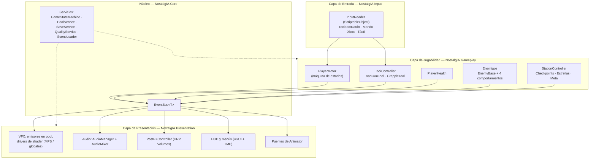
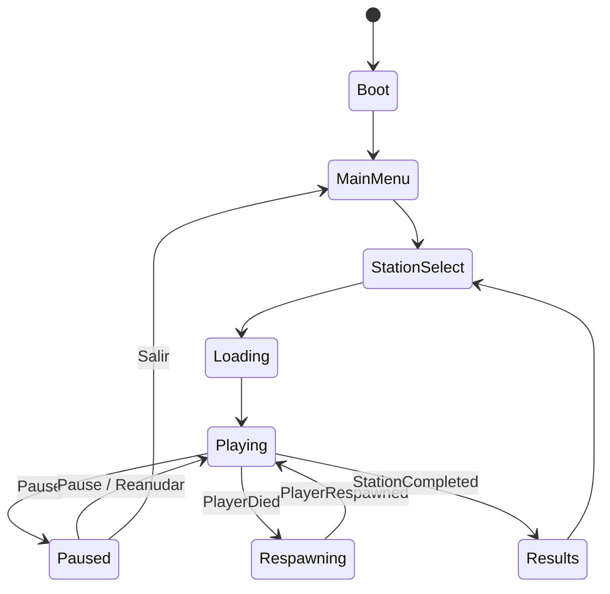
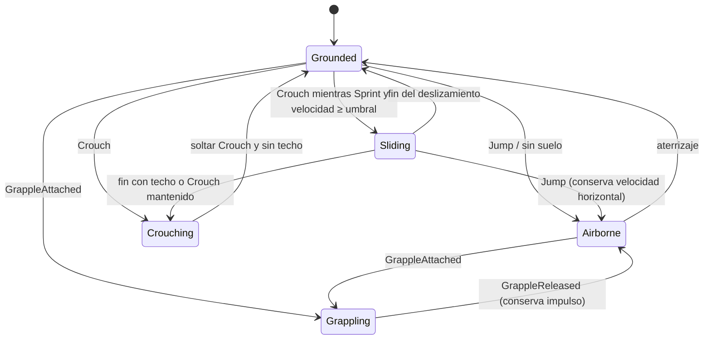
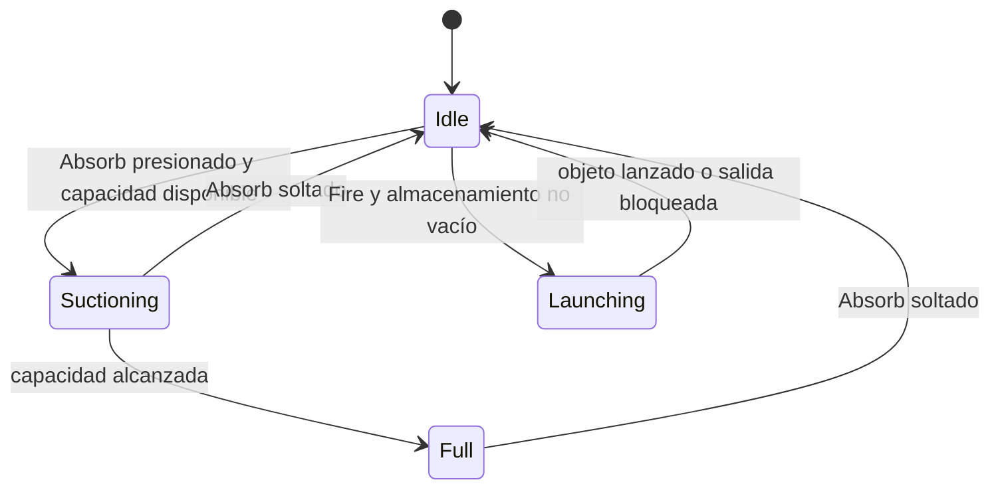

# Documento de Diseño Técnico (TDD) — Arquitectura de *NostalgIA*

**Proyecto:** *NostalgIA* — Plataformas 3D en primera persona  
**Asignatura:** Fundamentos Técnicos de VFX  
**Motor y pipeline:** Unity 6.3 (6000.3.7f1) · Universal Render Pipeline 17.3 · Input System 1.18 · ProBuilder 6.0  
**Plataformas:** PC (Windows/macOS) y dispositivos móviles (Android/iOS), con soporte de Mando de Xbox en ambas  
**Equipo:** Integrante 1 (Ingeniería de Gameplay, Físicas, IA y Optimización) · Integrante 2 (Technical Artist: Shaders, VFX, Iluminación, Modelado y UI)  
**Versión del documento:** 1.0 — 26 de octubre de 2026  
**Documentos relacionados:** `Docs/GDD.md`, `Docs/Requisitos.md`, `Docs/Planeacion_Costos_y_Gantt.md`, `Docs/Roadmap_Fases.md`

---

## 0. Propósito, alcance y punto de partida

Este documento define la arquitectura técnica con la que construiremos el resto de *NostalgIA*: organización del código, flujo de datos entre sistemas, esquema de entrada multiplataforma, arquitectura de los seis pilares de VFX exigidos por la asignatura, estructura de carpetas y modelo de datos configurable.

El punto de partida es el estado del repositorio al 26 de octubre de 2026 (rama `testing`, commit `e1ba801`), revisado en nuestra auditoría técnica interna. De esa revisión se derivan cuatro decisiones de partida:

1. **Se conserva** el núcleo jugable existente (máquina de estados del controlador en primera persona, física del gancho, trayectoria en espiral de absorción, cálculo de daño por F = m·a) y se reorganiza en módulos desacoplados.
2. **Se consideran finales** los modelos 3D de la herramienta (`robot.fbx`), del Antivirus (`winrarModel.fbx`), del Correo de Spam (`spamMail.fbx`) y del Troyano (`troyano.fbx`), así como el shader de **lava electrónica** del Tutorial (`BlueCodeLava`). Sobre estos activos solo resta producir animaciones; la arquitectura los integra sin modificarlos.
3. **Se reemplaza** la lectura directa de dispositivos (`Keyboard.current`, `Gamepad.current`) por una capa única basada en acciones del Input System.
4. **Se divide** el controlador de juego monolítico actual en servicios con una sola responsabilidad, comunicados mediante eventos.

No forman parte del alcance: multijugador, guardado en la nube, compras dentro de la aplicación, VFX Graph (descartado por compatibilidad con GPUs móviles de gama media, ver Planeación §7.3) ni el sistema `Terrain` de Unity (prohibido por la asignatura).

---

## 1. Principios de arquitectura

| # | Principio | Consecuencia práctica |
| :-: | :--- | :--- |
| P1 | **Simulación separada de presentación.** | El código de jugabilidad (movimiento, herramientas, enemigos, estación) nunca referencia partículas, audio, materiales ni UI. Publica eventos; la capa de presentación los escucha. |
| P2 | **Una sola fuente de entrada.** | Todo el juego lee acciones lógicas desde `InputReader`. Ningún script consulta un dispositivo concreto. |
| P3 | **Datos fuera del código.** | Valores de diseño (velocidades, alcances, capacidades, vida, presupuestos) viven en `ScriptableObject`. Las mejoras de progresión modifican copias en tiempo de ejecución, nunca el asset. |
| P4 | **Cero asignaciones en el bucle de juego.** | Consultas físicas `NonAlloc`, *object pooling*, eventos con `struct`, textos de HUD con `TMP_Text.SetText` y caché de componentes. Objetivo medible: 0 B de GC por frame en juego. |
| P5 | **Escalabilidad por niveles de calidad.** | Cada sistema visual expone parámetros que un `QualityProfile` ajusta por plataforma (resolución, sombras, partículas, postprocesado, cámara del portal). |
| P6 | **Estaciones construidas con mallas.** | Toda topografía es geometría modular ProBuilder/Blender. Un validador de editor bloquea el build si detecta un componente `Terrain`. |
| P7 | **Código documentado.** | Toda clase y método público lleva comentario XML (`/// <summary>`) en español que explica qué hace y por qué. |

---

## 2. Vista general por capas



### 2.1. Ensamblados (`.asmdef`) y reglas de dependencia

Dividimos el código en ensamblados para acortar la compilación y, sobre todo, para que el compilador impida violar el principio P1.

| Ensamblado | Contenido | Puede referenciar |
| :--- | :--- | :--- |
| `NostalgIA.Core` | `EventBus<T>`, catálogo de eventos, interfaces (`IDamageable`, `IPoolable`, `IResettable`), servicios genéricos, `ScriptableObject` de datos | Unity, Input System, URP |
| `NostalgIA.Input` | `InputReader`, clase C# generada del asset de acciones, controles táctiles, resolución de esquema | `Core` |
| `NostalgIA.Gameplay` | Motor del jugador, herramientas, salud, enemigos, estación, progresión | `Core`, `Input` |
| `NostalgIA.Presentation` | VFX, drivers de shader, audio, postprocesado, HUD, menús, puentes de animación | `Core`, `Input` (solo para glifos) |
| `NostalgIA.Editor` | Validadores, herramientas de montaje de escena, menús de editor | Todos (solo editor) |

`Gameplay` **no** referencia `Presentation`. La única vía de comunicación de jugabilidad hacia presentación es el bus de eventos.

### 2.2. Espacios de nombres y convenciones

- Raíz: `NostalgIA`. Subespacios por módulo: `NostalgIA.Gameplay.Player`, `NostalgIA.Gameplay.Tools`, `NostalgIA.Gameplay.Enemies`, `NostalgIA.Presentation.VFX`, etc.
- Campos de inspector: `[SerializeField] private` con `[Tooltip]` en español.
- Identificadores de shader y Animator en clases estáticas cacheadas (`ShaderIds`, `AnimatorIds`) mediante `Shader.PropertyToID` y `Animator.StringToHash`.
- Capas y etiquetas en constantes (`Layers`, `Tags`); se prohíben cadenas mágicas y búsquedas por nombre de GameObject.

---

## 3. Ciclo de vida, escenas y estados de juego

### 3.1. Escenas

| Escena | Rol | Carga |
| :--- | :--- | :--- |
| `00_Boot` | Instancia el prefab persistente `GameRoot` (servicios) y aplica calidad, configuración y guardado | Primera del build, una vez |
| `01_MainMenu` | Menú principal y opciones | Única (`LoadSceneMode.Single`, `GameRoot` persiste) |
| `02_StationSelect` | Selección de estación con estrellas obtenidas | Única |
| `10_Station_Primavera` | Estación 1 (incluye la secuencia tutorial) | Única, asíncrona con pantalla de carga |
| `20_Station_Verano` | Estación 2 | Única, asíncrona |
| `30_Station_Otono` | Estación 3 | Única, asíncrona |
| `40_Station_Invierno` | Estación 4 (núcleo de la IA) | Única, asíncrona |
| `OtherDimension` | Dimensión enlazada por el portal no euclidiano del Tutorial | Aditiva, como hoy |

Las escenas de prueba (`Prototype`, `EnemyTest`) salen de *Build Settings* y se conservan en `Assets/_Project/Scenes/Sandbox/`.

### 3.2. Máquina de estados de juego

`GameStateMachine` (servicio persistente) gobierna los estados globales, el bloqueo del cursor, la escala de tiempo y el mapa de acciones activo.



| Estado | `Time.timeScale` | Mapa de acciones | Cursor | Controles táctiles |
| :--- | :-: | :--- | :--- | :--- |
| MainMenu / StationSelect / Results | 1 | `UI` | Libre | Ocultos |
| Loading | 1 | Ninguno | Oculto | Ocultos |
| Playing | 1 | `Gameplay` | Bloqueado (PC) | Visibles si el esquema es Táctil |
| Paused | 0 | `UI` | Libre | Ocultos (solo menú) |
| Respawning | 1 | Ninguno (≈ 0,8 s) | Bloqueado | Ocultos |

Cada transición publica `GameStateChanged`, que consumen el HUD, el audio (instantáneas del mezclador) y el postprocesado.

---

## 4. Bus de eventos

### 4.1. Diseño

Elegimos un bus estático y genérico por tipo de evento, con eventos definidos como `struct` de solo lectura. Frente a canales `ScriptableObject` o `UnityEvent`, esta opción no asigna memoria al publicar, es verificable por el compilador y su costo es una invocación de delegado por suscriptor.

```csharp
namespace NostalgIA.Core.Events
{
    /// <summary>Marca un tipo como evento del juego. Los eventos son structs inmutables.</summary>
    public interface IGameEvent { }

    /// <summary>
    /// Bus estático por tipo de evento. Publicar no asigna memoria: el evento viaja por referencia
    /// de solo lectura y los suscriptores se guardan en un delegado multicast.
    /// </summary>
    public static class EventBus<T> where T : struct, IGameEvent
    {
        public delegate void Handler(in T evt);
        private static Handler handlers;

        /// <summary>Suscribe un oyente. Llamar en OnEnable.</summary>
        public static void Subscribe(Handler handler) => handlers += handler;

        /// <summary>Cancela la suscripción. Llamar en OnDisable.</summary>
        public static void Unsubscribe(Handler handler) => handlers -= handler;

        /// <summary>Publica el evento a todos los oyentes registrados.</summary>
        public static void Raise(in T evt) => handlers?.Invoke(in evt);

        /// <summary>Limpia suscriptores al recargar el dominio (Enter Play Mode sin recarga).</summary>
        [UnityEngine.RuntimeInitializeOnLoadMethod(UnityEngine.RuntimeInitializeLoadType.SubsystemRegistration)]
        private static void ResetStatics() => handlers = null;
    }
}
```

Reglas de uso:

- Suscripción en `OnEnable` y cancelación en `OnDisable`, sin excepción.
- Los oyentes no publican eventos del mismo tipo dentro de su manejador (evita recursión).
- Los objetos en *pool* se suscriben al activarse y se desuscriben al regresar al *pool*.
- Para estado continuo de alta frecuencia (velocidad del jugador, porcentaje de llenado en animación) no se publican eventos por frame: la presentación consulta una interfaz de solo lectura (`IPlayerMotionState`, `IVacuumState`) registrada en un `ServiceLocator` mínimo de `Core`.

### 4.2. Catálogo de eventos

| Evento | Carga útil | Publica | Consumidores principales |
| :--- | :--- | :--- | :--- |
| `GameStateChanged` | estado anterior, estado nuevo | `GameStateMachine` | HUD, Audio, PostFX, controles táctiles |
| `InputSchemeChanged` | esquema (`KeyboardMouse`, `Gamepad`, `Touch`) | `InputSchemeResolver` | HUD (glifos), controles táctiles, tutorial |
| `LocomotionStateChanged` | estado anterior, estado nuevo | `PlayerMotor` | Audio (pasos), VFX (*speed lines*), CameraFX |
| `PlayerJumped` | posición, velocidad | `PlayerMotor` | Audio, VFX |
| `PlayerLanded` | posición, velocidad de impacto | `PlayerMotor` | Audio, VFX (polvo digital), CameraFX |
| `SlideStarted` / `SlideEnded` | posición, velocidad | `PlayerMotor` | Audio, VFX (chispas), PostFX (distorsión leve) |
| `ToolSwitched` | herramienta nueva | `ToolController` | Animator de la herramienta, HUD, Audio, controles táctiles |
| `ToolCooldownChanged` | segundos restantes, normalizado 0–1 | `ToolController` | HUD (retícula), shader de la herramienta |
| `SuctionStateChanged` | activo/inactivo, origen, dirección | `VacuumTool` | VFX (vórtice), Audio (bucle), Animator |
| `ObjectAbsorbed` | almacenados, capacidad, tipo de objeto | `VacuumTool` | Driver de inflado, Audio, HUD |
| `ObjectLaunched` | origen, dirección, almacenados, capacidad | `VacuumTool` | VFX (*muzzle flash* + estela), Audio, CameraFX, driver de inflado |
| `VacuumFull` / `VacuumEmptyTrigger` | — | `VacuumTool` | Audio, HUD |
| `GrappleFired` | origen, punto objetivo, impactó | `GrappleTool` | Animator, VFX (cable), Audio |
| `GrappleAttached` | punto, normal | `GrappleTool` | VFX (chispa de anclaje), Audio, CameraFX |
| `GrappleReleased` | velocidad conservada | `GrappleTool` | VFX, Audio, Animator |
| `AimTargetChanged` | tipo (`Ninguno`, `Absorbible`, `Anclaje`, `FueraDeRango`) | `AimService` | Retícula |
| `ProjectileImpact` | punto, normal, superficie, fuerza | `Absorbable`, proyectiles enemigos | VFX (impacto), Audio |
| `BreakableDestroyed` | punto, tipo | `Breakable` | VFX (fragmentos), Audio |
| `PlayerDamaged` | daño, vida actual, vida máxima, dirección de origen | `PlayerHealth` | HUD, PostFX (pulso), Audio, CameraFX |
| `PlayerDied` | causa (`Corazones`, `Vacío`, `Instakill`) | `PlayerHealth` | `RespawnService`, PostFX, Audio, HUD |
| `PlayerRespawned` | checkpoint | `RespawnService` | HUD, Audio, VFX |
| `EnemySpawned` / `EnemyDamaged` / `EnemyKilled` | tipo, posición, daño | `EnemyBase` | VFX (disolución digital), Audio, Animator |
| `AntivirusSlam` | posición, radio | `AntivirusBehaviour` | VFX (onda), CameraFX, Audio |
| `StarCollected` | índice (0–2), total en estación | `Star` | HUD, Audio, VFX, progresión |
| `CheckpointActivated` | índice | `Checkpoint` | HUD, Audio, VFX |
| `StationCompleted` | estación, estrellas, tiempo | `StationController` | Progresión, Resultados, Audio |
| `UpgradeApplied` | mejora | `ProgressionService` | HUD, escala/visual de la herramienta |
| `CorruptionLevelChanged` | nivel 0–1 | `StationController` (Invierno) | Shader global de *glitch*, PostFX, Audio |

---

## 5. Jugador: movimiento, vida y reaparición

### 5.1. `PlayerMotor` (máquina de estados)

El controlador actual se basa en el asset externo *EasyPeasy First Person Controller*, ya modificado por el equipo. Su código derivado se traslada a `NostalgIA.Gameplay.Player` conservando la atribución en la cabecera de cada archivo y en `CREDITS.md`; la carpeta original se reduce a su licencia y documentación en `Assets/ThirdParty/`.



| Estado | Responsabilidad | Notas de diseño |
| :--- | :--- | :--- |
| `Grounded` | Caminar y correr con aceleración/desaceleración | Correr requiere `Sprint` y avance positivo |
| `Crouching` | Reduce cápsula y cámara; detección de techo | Altura y velocidad en `MotorSettings` |
| `Sliding` | Inercia, pendientes, dirección lateral, choque frontal | Entrada por `Crouch` estando en `Sprint`; funciona igual en los tres esquemas |
| `Airborne` | Gravedad y control aéreo | **Conservación de impulso:** el control aéreo solo acelera hacia la entrada mientras la velocidad horizontal sea menor que `maxAirSpeed`; por encima, solo actúa un arrastre aéreo bajo. Así un salto tras deslizarse o soltar el gancho no pierde velocidad. |
| `Grappling` | Integración de la tracción del gancho con subpasos (≈ 90 Hz) | Sustituye a la clase parcial actual `FirstPersonController.Grapple`; misma física probada |

Los estados de nado y agarre de cornisa existentes quedan **desactivados** por no formar parte del GDD.

El motor implementa `IPlayerMotionState` (velocidad, estado, en suelo, normal del suelo) para que la presentación lea datos continuos sin eventos por frame.

**Presencia física indirecta del dron cámara (GDD §1.1).** Para que el jugador perciba su cuerpo robótico en sombras proyectadas, portales/reflejos y al morir sin obstruir la vista en primera persona, el prefab `Player` incorpora una malla *proxy* del dron cámara configurada con `ShadowCastingMode.ShadowsOnly` durante el estado `Playing`. Al entrar en `Respawning` (secuencia de muerte de 0,8 s), un componente de presentación conmuta temporalmente el modo a `ShadowCastingMode.On` para mostrar la silueta o caída del dron antes del fundido.

### 5.2. `PlayerHealth`, daño y muerte

- Implementa `IDamageable.TakeDamage(in DamageInfo info)`; `DamageInfo` es un `struct` con cantidad, tipo (`Normal`, `Instakill`), posición de origen y causa.
- Corazones máximos y tiempo de invulnerabilidad se leen de `PlayerSettings` (ScriptableObject).
- Los peligros de muerte instantánea (lava electrónica, vacío, Antivirus) envían `DamageType.Instakill`, que ignora la invulnerabilidad.
- El vacío se detecta con volúmenes `KillVolume` por estación, no con un umbral global de altura.

### 5.3. Reaparición sin recargar la escena

`RespawnService` sustituye la recarga completa de escena:

1. Recibe `PlayerDied`, cambia el estado global a `Respawning` y espera la transición visual.
2. Desactiva el `CharacterController`, coloca al jugador en el último `Checkpoint` activo, restablece velocidad, corazones y herramienta (gancho liberado, succión detenida).
3. Notifica a los objetos registrados como `IResettable` (enemigos, peligros móviles, barreras) para volver a su estado inicial.
4. Publica `PlayerRespawned` y regresa a `Playing`.

Los checkpoints son componentes colocados en la escena con un índice; **su posición real en la escena es la fuente de verdad**. Las estrellas recogidas y los checkpoints activos persisten durante la estación.

---

## 6. Herramientas

### 6.1. `ToolController` e interfaz `ITool`

```csharp
/// <summary>Contrato común de las herramientas intercambiables del dron.</summary>
public interface ITool
{
    ToolId Id { get; }
    /// <summary>Se llama al seleccionar la herramienta.</summary>
    void Equip();
    /// <summary>Se llama al cambiar a otra herramienta; debe cancelar acciones en curso.</summary>
    void Unequip();
    /// <summary>Procesa la entrada ya filtrada por el ToolController para este frame.</summary>
    void Tick(in ToolInput input, in AimSample aim, float deltaTime);
}
```

`ToolController`:

- Mantiene **una sola herramienta activa** (GDD 2.3) y procesa `SwitchTool`.
- Traduce las acciones lógicas a `ToolInput` según la herramienta activa (ver §7.3).
- Administra un **bloqueo de enfriamiento compartido**: tras usar el gancho, ninguna de las dos herramientas acepta acciones hasta que el ducto se retrae (GDD 2.3, *Cooldown*).
- Publica `ToolSwitched` y `ToolCooldownChanged`.

### 6.2. `AimService`

Calcula una sola vez por frame la muestra de puntería (`AimSample`: rayo, impacto, distancia, tipo de objetivo) con `Physics.Raycast` sobre una máscara que excluye la capa `Player` y los *triggers*. Ambas herramientas y la retícula consumen la misma muestra, lo que elimina las llamadas repetidas a `Physics.RaycastAll` del prototipo. Publica `AimTargetChanged` únicamente cuando cambia el tipo de objetivo.

### 6.3. Aspiradora Lanzadora (`VacuumTool`)



**Detección en cono (vórtice).** Mientras `Absorb` está activo, cada paso de física se ejecuta `Physics.OverlapSphereNonAlloc` sobre la capa `Absorbable` con radio igual al alcance; se filtran los candidatos por ángulo (`Vector3.Dot(dir, forward) ≥ cos(semiángulo)`) y por línea de visión (`Physics.Raycast`). Hasta `maxSimultaneousPulls` objetos inician su trayectoria de absorción a la vez, lo que permite barrer una zona girando la cámara (GDD 2.2). Los enemigos nunca están en la capa `Absorbable` y, además, se exige el componente `Absorbable`.

**Trayectoria.** Cada `Absorbable` conserva la trayectoria en espiral del prototipo (interpolación hacia la boquilla, radio senoidal y reducción de escala), ahora parametrizada desde `VacuumStats`.

**Almacenamiento FIFO.** Los objetos se guardan en una cola de capacidad fija:

```csharp
/// <summary>
/// Almacén FIFO de la aspiradora: el primer objeto absorbido es el primero en dispararse (GDD 2.3 A).
/// Si la salida está bloqueada, el objeto permanece al frente de la cola y no se consume.
/// </summary>
public sealed class VacuumStorage
{
    private readonly Queue<Absorbable> queue;
    public int Count => queue.Count;
    public int Capacity { get; private set; }
    public float Fill01 => Capacity > 0 ? (float)queue.Count / Capacity : 0f;

    public VacuumStorage(int capacity) { Capacity = capacity; queue = new Queue<Absorbable>(capacity); }
    public bool TryStore(Absorbable item) { if (queue.Count >= Capacity) return false; queue.Enqueue(item); return true; }
    public bool TryPeek(out Absorbable item) => queue.TryPeek(out item);
    public Absorbable Dequeue() => queue.Dequeue();
    /// <summary>Aplica la mejora de capacidad sin perder los objetos almacenados.</summary>
    public void SetCapacity(int capacity) => Capacity = Mathf.Max(capacity, queue.Count);
}
```

El objeto almacenado se desactiva y queda bajo el control de la aspiradora; no se destruye. Su caja de colisión se captura al almacenarlo para calcular el punto de salida.

**Disparo.** `Fire` consulta el frente de la cola (`TryPeek`), verifica con `Physics.Raycast` que el trayecto de salida esté libre, coloca el objeto frente a la boquilla, aplica el impulso hacia el punto de la retícula y el giro, y lo marca como lanzado por el jugador para el cálculo de daño. Solo entonces se retira de la cola. Publica `ObjectLaunched`.

**Usos físicos.** Al impactar, `Absorbable` publica `ProjectileImpact` y entrega el impacto al receptor mediante interfaces: `IDamageable` (enemigos, daño por F = m·a con mínimo garantizado), `IImpactReceiver` (botones y mecanismos) y `Breakable` (barreras frágiles). Los empujes de objetos pesados los resuelve el motor de física sin código adicional.

### 6.4. Gancho (`GrappleTool`)

Conserva la física validada del prototipo, con sus parámetros movidos a `GrappleStats`:

- Disparo con la muestra de `AimService`; solo engancha superficies de la capa `Grapple` dentro de `maxRange`. Una superficie incompatible o fuera de rango produce retracción sin impulso (se publica `GrappleFired` con `impactó = false`).
- Tracción con rampa de aceleración, velocidad límite hacia el ancla, gravedad reducida, límite de duración, detección de llegada por segmento recorrido, rebase máximo y liberación por bloqueo.
- Cancelación con la misma acción, conservando el porcentaje de velocidad configurado (`releaseMomentumRetention`, 0,85 por defecto).
- Al liberar, `ToolController` inicia el enfriamiento compartido.
- Nunca engancha enemigos: no pertenecen a la capa `Grapple`.

### 6.5. Retroalimentación visual de la herramienta (inflado)

El modelo final `robot.fbx` (con huesos) recibe tres capas de retroalimentación, todas en `Presentation`:

1. **Animator** con capas *Base* (inactivo, aspirar, disparar, gancho) y *Garras* (transición aspiradora ↔ gancho), alimentado por `ToolAnimatorBridge` a partir de eventos.
2. **Shader `NOS/VacuumInflate`** sobre el material del depósito: deformación de vértices a lo largo de la normal, emisión progresiva y onda peristáltica al tragar (detalle en §8.1).
3. **`VacuumVisualDriver`**: escucha `ObjectAbsorbed` y `ObjectLaunched`, suaviza el valor de llenado y escribe `_Fill01`, `_SwallowPhase` y `_DeflatePulse` mediante `MaterialPropertyBlock` en el `SkinnedMeshRenderer`.

El escalado de huesos del prototipo (`ToolVisualController`) se conserva para garras, aletas y cabezal del gancho, y se retira del depósito, cuya deformación pasa al shader.

**Contrato anatómico con el rig de `robot.fbx`.** En la jerarquía final del modelo, el depósito está compuesto por dos sub-mallas cilíndricas asociadas a `Bone.003` (`Cylinder`, tanque trasero) y `Bone.004` (`Cylinder.001`, tanque delantero). Dado que `Bone.004` cuelga originalmente de `Bone.002` (el cabezal articulado de tres garras que sale disparado hacia el punto de anclaje al usar el gancho), el puente de presentación re-emparenta `Bone.004` a `Bone.001` durante la inicialización (`Awake`). De este modo, ambos tanques permanecen solidarios al cuerpo del arma y reciben `NOS/VacuumInflate` por `MaterialPropertyBlock`, mientras que el cabezal `Bone.002` puede proyectarse libremente unido por el ducto extensible. Asimismo, se eliminan las instanciaciones en tiempo de ejecución (`new Material` y `new Texture2D`) presentes en `ToolVisualController` y `ToolRayVisual`, sustituyéndolas por materiales como assets en `Assets/_Project/Art/Materials/VFX/`.

---

## 7. Entrada multiplataforma

### 7.1. Asset de acciones y esquemas de control

El asset existente `InputSystem_Actions.inputactions` se reestructura en dos mapas: `Gameplay` y `UI`. Se genera su clase C# (`NostalgIAInputActions`) y se conservan tres esquemas de control: `KeyboardMouse`, `Gamepad` y `Touch`. Los esquemas `Joystick` y `XR` se eliminan.

| Acción | Tipo | Teclado y ratón | Mando Xbox | Táctil |
| :--- | :--- | :--- | :--- | :--- |
| `Move` | Value · Vector2 | `W` `A` `S` `D` | Stick izquierdo | Pad virtual izquierdo dinámico |
| `LookDelta` | Value · Vector2 (*pass-through*) | Delta del ratón | — | Arrastre en la zona derecha |
| `LookStick` | Value · Vector2 | — | Stick derecho | — |
| `Jump` | Button | `Espacio` | `A` | Botón en pantalla |
| `Sprint` | Button (mantener) | `Shift` izquierdo | `L3` (mantener) | Pad izquierdo llevado al borde superior (≥ 0,9) |
| `Crouch` | Button | `C` (reasignable) | `R3` | Botón en pantalla |
| `SwitchTool` | Button | `F` (reasignable) | `Y` | Botón de cambio de herramienta |
| `Absorb` | Button (mantener) | Clic derecho | `LT` | Mantener el pad derecho (con aspiradora) |
| `Fire` | Button | Clic izquierdo | `RT` | Tocar el pad derecho (con aspiradora) |
| `Grapple` | Button | Clic derecho | `RT` | Botón de gancho (pad derecho con gancho) |
| `Pause` | Button | `Esc` | `Start` (Menú) | Botón de pausa del HUD |

El deslizamiento no es una acción independiente: el motor lo deriva de `Crouch` mientras se corre (GDD 2.2). El mapa `UI` contiene `Navigate`, `Submit`, `Cancel`, `Point`, `Click` y `ScrollWheel`, usados por `InputSystemUIInputModule`.

### 7.2. `InputReader`

`InputReader` es un `ScriptableObject` que implementa la interfaz de *callbacks* del mapa `Gameplay` generado. Expone:

- Valores continuos de lectura directa: `Move`, `LookDegrees` (ya convertido a grados de este frame), `SprintHeld`, `AbsorbHeld`.
- Eventos de pulsación: `JumpPressed`, `CrouchPressed/Released`, `SwitchToolPressed`, `FirePressed`, `GrapplePressed`, `PausePressed`.

Combinación de la mirada sin ramas por dispositivo:

```text
LookDegrees = LookDelta × sensibilidadRatónOTáctil
            + CurvaRespuesta(LookStick, zonaMuerta) × velocidadMáximaStick × Δt
```

Ambas fuentes se suman, de modo que conectar un mando no desactiva el ratón ni viceversa. La aceleración analógica existente se conserva solo para el término del stick.

`InputReader` activa el mapa que indique `GameStateMachine` y aplica las reasignaciones guardadas (`SaveBindingOverridesAsJson` / `LoadBindingOverridesFromJson`).

### 7.3. Resolución contextual de las acciones de herramienta

El GDD asigna un mismo control a acciones distintas según la herramienta activa (clic derecho = absorber o enganchar en PC; `RT` = disparar o enganchar en mando). Las tres acciones (`Absorb`, `Fire`, `Grapple`) se definen por separado, aunque compartan control, y `ToolController` solo traslada a la herramienta activa las que le corresponden:

| Herramienta activa | Acciones atendidas | Acciones ignoradas |
| :--- | :--- | :--- |
| Aspiradora | `Absorb`, `Fire` | `Grapple` |
| Gancho | `Grapple` | `Absorb`, `Fire` |

### 7.4. Detección del esquema activo

`InputSchemeResolver` escucha `InputSystem.onActionChange` y, ante cada acción realizada, identifica el dispositivo de origen:

- `Keyboard` o `Mouse` → `KeyboardMouse`.
- `Gamepad` físico → `Gamepad`.
- `Touchscreen`, o el mando virtual que crean los controles en pantalla (`OnScreenControl`), → `Touch`.

Al cambiar el esquema publica `InputSchemeChanged`. El HUD sustituye los glifos de ayuda (`InputGlyphSet` por esquema) y el lienzo táctil se muestra solo con el esquema `Touch`. Así un mando Bluetooth conectado a un móvil oculta los controles táctiles automáticamente.

### 7.5. Controles táctiles dinámicos

| Control | Implementación | Comportamiento |
| :--- | :--- | :--- |
| Pad izquierdo | `DynamicTouchStick` (derivado de `OnScreenControl`, ruta `<Gamepad>/leftStick`) | Aparece donde el dedo toca la mitad izquierda; radio en `TouchLayoutSettings`; magnitud ≥ 0,9 hacia arriba activa `Sprint` |
| Zona de mirada | `TouchLookZone` con `EnhancedTouch` | Arrastre en la mitad derecha fuera de botones; escribe en `LookDelta` |
| Pad derecho de herramienta | `TouchToolPad` | Con aspiradora: mantener > 0,2 s = `Absorb`, toque corto = `Fire`. Con gancho: toque = `Grapple`. Icono según `ToolSwitched` |
| Botones | `OnScreenButton` | Saltar, agacharse, cambiar herramienta y pausa; iconografía universal y contorno contrastado |

El lienzo táctil usa `SafeAreaFitter` para respetar recortes de pantalla y opacidad del 45 % para no ocultar la vista central.

### 7.6. Configuración del usuario

`SettingsService` guarda sensibilidad (ratón, táctil y stick por separado), inversión del eje Y, reasignaciones, nivel de calidad y volúmenes por grupo del mezclador.

---

## 8. Arquitectura de los seis pilares de VFX

### 8.1. Pilar 1 — Shaders personalizados (URP)

#### 8.1.1. Convenciones obligatorias

1. **Compatibilidad con SRP Batcher:** todas las propiedades del material dentro de `CBUFFER_START(UnityPerMaterial)`; texturas y *samplers* fuera; misma disposición del búfer en todos los pases.
2. **Pases:** `UniversalForward`; `ShadowCaster` si el objeto proyecta sombra; `DepthOnly` y `DepthNormals` en opacos (necesarios para SSAO y *depth priming* en PC). La lava electrónica es activo final y se conserva sin cambios.
3. **Variantes:** solo `shader_feature_local` para opciones de material. Una única palabra clave global de plataforma, `_NOS_MOBILE`, declarada con `multi_compile` solo en los shaders que la necesitan, para mantener el número de variantes bajo control.
4. **Biblioteca común:** `NostalgIA_Common.hlsl` con *hashes*, ruido de valor, paleta coseno, Fresnel y matrices de *dithering* Bayer 4×4.
5. **Precisión:** `half` en color y factores normalizados; `float` en posiciones y tiempo.
6. **Materiales como assets** en `Art/Materials/`; ningún material se crea con `new Material` durante el juego.

#### 8.1.2. Variación por instancia: `MaterialPropertyBlock` frente a SRP Batcher

Un `Renderer` con `MaterialPropertyBlock` asignado queda fuera del SRP Batcher y se dibuja por la ruta estándar. Por eso definimos tres mecanismos según la cantidad de objetos afectados:

| Mecanismo | Uso en *NostalgIA* | Costo |
| :--- | :--- | :--- |
| **Propiedades globales** (`Shader.SetGlobalFloat`) | Nivel de corrupción de Invierno, pulso de daño, tiempo de escaneo Webcore | Nulo por objeto; mantiene el SRP Batcher |
| **`MaterialPropertyBlock`** | Pocos objetos dinámicos y relevantes: inflado de la herramienta, destello y disolución de enemigos, intensidad de *glitch* por objeto | Cada objeto sale del SRP Batcher; aceptable por ser pocos (< 30 visibles) |
| **Materiales compartidos** | Geometría de nivel, objetos absorbibles, decoración | Agrupados por el SRP Batcher y *static batching* |

Esta distinción se documenta en la memoria técnica como decisión de rendimiento justificada.

#### 8.1.3. Catálogo de shaders

| Shader | Estación / uso | Técnica matemática | Control desde C# | Alternativa móvil |
| :--- | :--- | :--- | :--- | :--- |
| `Tutorial/BlueCodeLava` (lava electrónica) | Primavera — peligro | Glifos 5×5 por máscara de bits, dos capas con paralaje, desplazamiento UV en espacio de mundo, *scanlines* CRT | Ninguno (animado por `_Time`) | **Activo final, sin cambios** |
| `NOS/WebcoreScreen` | Primavera — techos, pisos y paneles de código | Desplazamiento UV de un atlas de código, pixelado en espacio de pantalla (`floor(uv × resolución) / resolución`), *dithering* Bayer 4×4 para aparición/desvanecimiento sin transparencia | Global `_NOS_ScanTime`; `_PixelSize` por material | Sin pixelado de pantalla |
| `NOS/AeroBubble` | Verano — burbujas, agua y cristal | Fresnel `F = (1 − saturate(N·V))^p`; iridiscencia con paleta coseno `a + b·cos(2π(c·F + d + t))`; desplazamiento de vértices `pos += N · A · sin(ωt + k·(pos·dir))`; refracción con `_CameraOpaqueTexture` desplazada por la normal | `_WobbleAmp` por instancia solo en burbujas focales | Sin refracción (textura opaca desactivada); reflejo con *cubemap* |
| `NOS/GlitchCorruption` | Invierno — monitores, paredes de circuito, IA | Desfase de vértices por bloques: `b = floor(pos.y · bloques)`, `n = hash(b + floor(t · tasa))`, `offset = step(1 − I, n) · (n − 0,5) · amplitud`; separación RGB por desplazamiento de UV; líneas de escaneo | Global `_NOS_Corruption` (`CorruptionLevelChanged`) + MPB `_GlitchBoost` en objetos focales | Sin separación RGB |
| `NOS/VacuumInflate` | Herramienta — depósito (`Bone.003` y `Bone.004`) | Máscara en espacio de objeto `m = 1 − smoothstep(r₀, r₁, |pos − centro|)` (sin modificar la malla final); `pos += N · m · (fill · A + onda)`; onda peristáltica gaussiana `exp(−((x − fase)·k)²)`; emisión `lerp(base, lleno, fill)` | MPB `_Fill01`, `_SwallowPhase`, `_DeflatePulse` | Igual (costo solo de vértices) |
| `NOS/DigitalDissolve` | Enemigos y objetos en *pool* — aparición y muerte | Umbral de ruido de valor con *clip*; borde emisivo `smoothstep(t, t + ancho, ruido)`; cuantización a píxeles para estética digital | MPB `_Dissolve` (0 a 1) | Igual |
| `NOS/LiminalChecker` | Otoño — pisos de damero, pasillos retorcidos y pantallas de bustos | Damero procedural en espacio de objeto/mundo con distorsión espacial senoidal `uv' = uv + A·sin(posWS.xz·k + ωt)`, filtrado analítico por derivadas (`fwidth`) para evitar *aliasing* en la distancia y atenuación emisiva acoplada a la niebla | Global `_NOS_ScanTime`; `_WarpAmp` por material | Sin distorsión secundaria; mantiene filtrado anti-*aliasing* |
| `NOS/RetroBillboard` | Las 4 Estaciones — elementos 2D en espacio 3D (collage *ENA* / Y2K: ventanas emergentes, cursores, flora/iconos retro, ojos) | Rotación cilíndrica o esférica resuelta íntegramente en el Vertex Shader (`posWS = pivoteWS + camRight·posOS.x·sx + ejeUp·posOS.y·sy`, cero `Transform.LookAt` en CPU), cuantización cromática (`floor(col·N)/N`) y recorte por matriz Bayer 4×4 (`clip(alpha − bayer)`) para escribir profundidad sin costo de *overdraw* transparente | `_BillboardMode` (`shader_feature_local`), `_PosterizeSteps` | Igual (opaco con *alpha-clip*, óptimo para GPUs TBDR móviles) |
| `NOS/ToolBeam` | Herramienta — ducto/cable de tensión del gancho, guía óptica y líneas de flujo de succión (reemplaza a `Resources/ToolRay.shader`) | Pulso de energía viajero `p = 0,5 + 0,5·sin(uv.x·k − ωt)`, perfil transversal suave `1 − |2·uv.y − 1|^p` y modulación de frecuencia según tensión del anclaje | MPB `_Tension01`, `_BeamColor` sobre `LineRenderer` con material compartido | Una sola onda senoidal sin capa secundaria |
| `Tutorial/DimensionalPortal` | Tutorial / Primavera — portal no euclidiano | Muestreo de `RenderTexture` en espacio de pantalla (`screenPos.xy / screenPos.w`) con ondulación perimetral `sin/cos` restringida al marco y borde emisivo `smoothstep`; se añade pase `DepthOnly` y cabecera técnica en español | Cámara del portal (`NonEuclideanPortal`) | Resolución del RT reducida (0,5×) por `QualityProfile` |

> **Retiro de shaders triviales.** El shader provisional `Assets/Resources/ToolRay.shader` (`Tools/VisibleRay`, color plano sin `CBUFFER` ni lógica matemática) se elimina en la Fase 3 y sus usos migran a `NOS/ToolBeam` mediante materiales compartidos, cumpliendo tanto la compatibilidad con el SRP Batcher como la exigencia académica de no emplear shaders básicos sin lógica adicional (`Docs/Requisitos.md` §3.1).

Cada shader incluye en su cabecera un bloque de comentarios con la fórmula, los parámetros y su costo estimado, que alimenta la memoria técnica en PDF.

### 8.2. Pilar 2 — Sistemas de partículas reactivos

Usamos Shuriken (`ParticleSystem`) con materiales `Universal Render Pipeline/Particles/Unlit` o un shader propio aditivo. Ningún efecto se instancia con `Instantiate` durante el juego: todos se solicitan al `PoolService` mediante `VfxSpawner` en respuesta a eventos.

| Efecto | Evento disparador | Tipo | Máx. partículas PC / móvil | *Pool* inicial |
| :--- | :--- | :--- | :-: | :-: |
| Vórtice de absorción (espiral de aire hacia la boquilla) | `SuctionStateChanged` | Bucle; velocidad orbital + radial negativa | 160 / 60 | 1 (fijo en la herramienta) |
| Destello de salida digital | `ObjectLaunched` | Ráfaga + *flipbook* pixelado | 24 / 12 | 4 |
| Estela del proyectil | `ObjectLaunched` | `TrailRenderer` en el objeto lanzado, activado/desactivado | — | Uno por absorbible |
| Impacto y fragmentos | `ProjectileImpact`, `BreakableDestroyed` | Ráfaga de mallas (cubos/vóxeles) con color del objeto vía *custom vertex streams* + subemisor de chispas | 60 / 25 | 8 |
| Chispa de anclaje | `GrappleAttached` | Ráfaga radial orientada a la normal | 30 / 15 | 3 |
| Tensión del cable | Estado del gancho | `LineRenderer` con shader `NOS/ToolBeam` | — | 1 |
| *Speed lines* | `IPlayerMotionState` (gancho y deslizamiento) | Sistema anclado a cámara; emisión proporcional a la velocidad | 80 / 30 | 1 |
| Aparición y muerte de enemigos | `EnemySpawned`, `EnemyKilled` | `NOS/DigitalDissolve` + ráfaga de vóxeles | 40 / 20 | 6 |
| Onda de aplastamiento del Antivirus | `AntivirusSlam` | Anillo en el suelo + polvo digital | 50 / 25 | 2 |
| Estrella y checkpoint | `StarCollected`, `CheckpointActivated` | Destello + columna de datos | 40 / 20 | 2 |
| Ambiente Primavera | Estación activa | Bits flotantes (0/1) en volumen alrededor de la cámara | 150 / 50 | — |
| Ambiente Verano | Estación activa | Burbujas iridiscentes (`NOS/AeroBubble`), polen luminoso y cardúmenes de peces aéreos (partículas de malla con ondulación de nado en vértices `sin(ωt + posOS.z·k)` e *instancing* en GPU, cero costo en C#) | 150 / 50 | — |
| Ambiente Otoño | Estación activa | Ceniza y esporas dentro de la niebla | 200 / 70 | — |
| Ambiente Invierno | Estación activa y `CorruptionLevelChanged` | Chispas eléctricas y datos corruptos | 150 / 60 | — |

Presupuestos globales: 4 000 partículas simultáneas en PC y 1 000 en móvil. El `QualityProfile` aplica un multiplicador de emisión (1,0 PC; 0,4 móvil) y desactiva el módulo de colisión en móvil. Los sistemas usan *Culling Mode* automático y `stopAction = Callback` para regresar al *pool*.

### 8.3. Pilar 3 — Iluminación técnica

**Estrategia:** iluminación **mixta** con *lightmapping* de geometría estática, para proteger el presupuesto de GPU en móvil y reservar luz en tiempo real para la retroalimentación del jugador.

| Elemento | Configuración |
| :--- | :--- |
| Luz direccional principal | Modo `Mixed`; sombras en tiempo real hasta la distancia de sombras del `QualityProfile` |
| Modo de iluminación mixta | `Shadowmask` en el `LightingSettings` de cada estación; el nivel de calidad PC usa `Distance Shadowmask` y el móvil `Shadowmask` (`QualitySettings.shadowmaskMode`) |
| Luces puntuales decorativas | `Baked` (hoy las 15 del Tutorial son `Realtime`) |
| Luces dinámicas | `Realtime`, sin sombras, solo para herramienta, impactos y enemigos; límite por objeto 4 en PC y 2 en móvil |
| Geometría de nivel | Banderas `Contribute GI`, `Batching Static`, `Occluder Static` y `Occludee Static` |
| Objetos dinámicos | *Light Probe Groups* por zona |
| Reflejos | Una *Reflection Probe* horneada por zona; proyección de caja en PC |
| Lightmaps | No direccionales, tamaño máximo 1024, compresión de alta calidad, densidad base 10 texeles/unidad (20 en piezas focales) |
| Guía visual | Puntos de anclaje del gancho con emisión de color fijo; la puerta de meta con la luz clave de mayor intensidad de la estación |

| Estación | Ambiente y lenguaje de color | Luz clave |
| :--- | :--- | :--- |
| Primavera | Interior, azul de pantalla y gris de columnas; emisión del código | Cenital fría y difusa |
| Verano | Exterior, cielo cian saturado, sol cálido | Direccional fuerte, sombras definidas |
| Otoño | Liminal, magenta/cian apagados, niebla densa | Baja intensidad, fuentes puntuales escasas |
| Invierno | Placa base verde, alertas rojas | Emisión de monitores y chispas; contraluz verde |

Cada estación agrupa su configuración en un prefab `StationAtmosphere` que referencia su `AtmosphereProfile` (§10).

### 8.4. Pilar 4 — Postprocesado justificado (URP Volumes)

Cada escena de estación contiene un **Volume global** con su perfil y, si se requiere, **Volumes locales** para transiciones de zona. Un `PostFXController` persistente mantiene además un **Volume de retroalimentación** de prioridad alta cuyo peso se anima por eventos.

| Perfil | Efectos y valores iniciales | Justificación artística y técnica |
| :--- | :--- | :--- |
| `VP_Primavera` | Tonemapping Neutral; Color Adjustments contraste +20, saturación −10; Bloom umbral 0,9, intensidad 0,6; Vignette 0,2 | Alto contraste digital; el Bloom solo afecta al código emisivo de pantallas y lava |
| `VP_Verano` | Tonemapping ACES; exposición +0,3; saturación +25; White Balance cálido; Bloom intensidad 0,8, dispersión 0,7; *Lens Flare* del sol (solo PC) | Estética Frutiger Aero luminosa; brillo suave en agua y burbujas |
| `VP_Otono` | Color Adjustments saturación −35; Split Toning sombras cian / luces magenta; Vignette 0,35; Film Grain 0,2 (solo PC). *(Nota técnica URP: la niebla exponencial cuadrática con densidad 0,035 y tono violeta desaturado no reside en el `VolumeProfile`, sino en `RenderSettings` gobernado por `StationAtmosphere` desde `AtmosphereProfile`)* | Encierro y tensión liminal; la niebla de `RenderSettings` oculta el plano lejano y reduce la distancia de dibujo |
| `VP_Invierno` | Channel Mixer hacia verde; Bloom en chispas; Chromatic Aberration base 0,15 | Interior electrónico corrupto; base para los pulsos de la IA |
| `VP_Feedback` (dinámico) | Daño: Vignette roja + Chromatic Aberration 0,6 durante 0,35 s · Ataque de la IA: Lens Distortion −0,3 + Chromatic Aberration 1,0 · Gancho rápido: Lens Distortion −0,1 | Comunicar estado sin saturar el HUD |

Valores sujetos a calibración en la Semana 3. Por plataforma:

| Característica | PC | Móvil |
| :--- | :--- | :--- |
| HDR | Sí | No (Bloom con umbral < 1) |
| Bloom | Calidad alta | Reducción a un cuarto, filtrado simple |
| SSAO | Sí (*renderer feature* existente) | No |
| Depth of Field, Motion Blur, Film Grain | Solo si un perfil lo pide | No |
| Chromatic Aberration, Vignette, Color Grading | Sí | Sí (costo bajo) |

### 8.5. Pilar 5 — Optimización y rendimiento

#### 8.5.1. Object Pooling

```csharp
/// <summary>Contrato de los objetos reutilizables del PoolService.</summary>
public interface IPoolable
{
    /// <summary>Se llama al salir del pool: restablecer estado y suscribirse a eventos.</summary>
    void OnSpawned();
    /// <summary>Se llama al regresar al pool: detener efectos y cancelar suscripciones.</summary>
    void OnDespawned();
}
```

- `PoolService` mantiene un `UnityEngine.Pool.ObjectPool<PooledObject>` por `PoolDefinition` (ScriptableObject con prefab, tamaño inicial PC/móvil y máximo).
- El precalentamiento ocurre durante la pantalla de carga de cada estación.
- `PooledObject` regresa al *pool* por tiempo de vida, por `OnParticleSystemStopped` o por llamada explícita.
- Si un *pool* alcanza su máximo, se recicla la instancia activa más antigua en lugar de crear otra.

| *Pool* | PC (inicial / máx.) | Móvil (inicial / máx.) |
| :--- | :-: | :-: |
| Proyectil del Correo de Spam | 12 / 24 | 8 / 16 |
| Bug (generado por el Troyano) | 8 / 12 | 6 / 8 |
| VFX de impacto y fragmentos | 8 / 16 | 6 / 10 |
| VFX de destello, anclaje, estrella | 4 / 8 cada uno | 3 / 6 cada uno |
| Texto flotante de daño | 8 / 12 | 4 / 8 |
| `AudioSource` 3D | 16 / 24 | 12 / 16 |

#### 8.5.2. Técnicas de renderizado

| Técnica | Aplicación |
| :--- | :--- |
| SRP Batcher | Activo en ambos URP Assets; todos los shaders propios compatibles |
| *Static batching* | Geometría modular marcada `Batching Static` |
| GPU Instancing | Mallas repetidas no estáticas y partículas de malla |
| LOD Groups | Modelos de enemigos y piezas de más de 2 000 triángulos: LOD0, LOD1 (≈ 40 %), *culled*; transición con *cross-fade* por *dithering* (ya activo en URP) |
| Occlusion Culling | Horneado en estaciones cerradas (Primavera, Otoño, Invierno) |
| Distancia de dibujo | Plano lejano por estación y niebla en Otoño |
| Compresión de texturas | Android ASTC 6×6 (UI 4×4); PC BC7/DXT5; máximo 1024 px en móvil y mipmaps activos |
| Audio | Vorbis; ambientes en *streaming*; efectos cortos descomprimidos en memoria |
| Física | 473 cajas del Tutorial: las no interactivas pasan a colisión estática; capas de colisión podadas; interpolación solo en proyectiles lanzados |
| Cámara del portal | Resolución 0,85 en PC y 0,5 en móvil; se desactiva fuera de `maxRenderDistance` |

#### 8.5.3. Niveles de calidad (`QualityProfile`)

| Parámetro | PC | Móvil |
| :--- | :-: | :-: |
| URP Asset | `PC_RPAsset` (Forward+) | `Mobile_RPAsset` (Forward) |
| Escala de render | 1,0 | 0,8 |
| HDR / MSAA | Sí / 2× | No / desactivado |
| Textura opaca (`_CameraOpaqueTexture`) | Activa (submuestreo 2× para refracción de `NOS/AeroBubble`) | Desactivada (ahorro de ancho de banda en GPUs TBDR móviles) |
| Distancia de sombras | 50 m, 4 cascadas | 25 m, 1 cascada |
| Multiplicador de partículas | 1,0 | 0,4 |
| `Application.targetFrameRate` | Sin límite (VSync) | 60 en gama alta, 30 en gama media |

El `QualityService` elige el nivel al iniciar según la plataforma y permite que el usuario lo cambie en opciones.

#### 8.5.4. Presupuestos y metas medibles

| Métrica | PC mínimo (GTX 1050 Ti, 1080p) | Móvil mínimo (Adreno 618 / Mali-G76) |
| :--- | :-: | :-: |
| Cuadros por segundo | ≥ 60 estable | ≥ 30 estable |
| Tiempo de CPU por frame | ≤ 10 ms | ≤ 25 ms |
| *SetPass calls* | ≤ 300 | ≤ 120 |
| *Batches* | ≤ 1 500 | ≤ 250 |
| Triángulos visibles | ≤ 1,5 M | ≤ 300 k |
| GC por frame en juego | 0 B | 0 B |
| Memoria total | ≤ 2 GB | ≤ 900 MB |
| Carga de estación | ≤ 5 s | ≤ 10 s |

### 8.6. Pilar 6 — Integración de sistemas

La matriz siguiente fija qué responde a cada evento; es el contrato entre las dos pistas de trabajo del equipo.

| Evento | Shader | Partículas | Audio | Postprocesado | HUD | Cámara / Animator |
| :--- | :-: | :-: | :-: | :-: | :-: | :-: |
| `SuctionStateChanged` | — | Vórtice | Bucle de succión | — | — | Animator herramienta |
| `ObjectAbsorbed` | Inflado + onda | — | Trago | — | Pips de carga | — |
| `ObjectLaunched` | Desinflado | Destello + estela | Disparo | — | Pips de carga | Retroceso |
| `GrappleAttached` | — | Chispa de anclaje | Anclaje | — | — | Animator + sacudida leve |
| `GrappleReleased` / `SlideStarted` | — | *Speed lines* | Viento | Distorsión leve | — | FOV |
| `PlayerDamaged` | Pulso global | — | Golpe | Feedback de daño | Corazones | Sacudida direccional |
| `PlayerDied` / `PlayerRespawned` | Disolución pantalla | Reaparición | Muerte / reaparición | Fundido | Pantalla de muerte | — |
| `EnemyKilled` | Disolución | Vóxeles | Destrucción | — | — | Animator enemigo |
| `StarCollected` | — | Destello | Jingle | — | Contador | — |
| `CorruptionLevelChanged` | Glitch global | Chispas | Capa de tensión | Aberración cromática | — | — |

Los modelos finales de la herramienta, el Antivirus, el Correo y el Troyano se animan con `Animator` (clips pendientes de producción). Cada uno tiene un `AnimatorBridge` en `Presentation` que traduce eventos a parámetros (`Animator.StringToHash`), de modo que la lógica no depende de las animaciones.

---

## 9. Enemigos y estaciones

### 9.1. Arquitectura de enemigos

- `EnemyBase` (abstracta): vida y daño por F = m·a (algoritmo actual movido a `ImpactDamageResolver`), `IDamageable`, `IPoolable`, `IResettable`, percepción y publicación de eventos.
- `EnemyBrain`: máquina de estados genérica (`Idle`, `Detect`, `Attack`, `Recover`, `Dead`) con estados concretos por tipo.
- `PerceptionSensor`: evaluación cada 0,2 s con desfase aleatorio por instancia, `OverlapSphereNonAlloc` sobre la capa `Player` y comprobación de línea de visión.
- `EnemyData` (ScriptableObject) con vida, rangos, velocidades, daño y referencias de *pool*.

| Enemigo (GDD) | Prefab y modelo | Comportamiento | Estados específicos |
| :--- | :--- | :--- | :--- |
| Correo de Spam | `Enemy_SpamMail` · `spamMail.fbx` (final) | Distancia: flota, mantiene distancia preferida y dispara proyectiles del *pool* | `Hover`, `Charge`, `Shoot`, `Retreat` |
| Bugs | `Enemy_Bug` · modelo pendiente | Enjambre terrestre: persigue, trepa superficies, ataque por contacto o salto a la cara | `Crawl`, `Leap`, `Latched`, `Detach` |
| Troyano | `Enemy_Trojan` · `troyano.fbx` (final) | Aparenta ser escenario; al detectar al jugador se revela y libera oleadas de Bugs desde el *pool* hasta `maxActive` | `Disguised`, `Reveal`, `SpawnWave`, `Cooldown` |
| Antivirus | `Hazard_Antivirus` · `winrarModel.fbx` (final) | Obstáculo letal tipo *Thwomp*: espera elevado, detecta al jugador debajo con `BoxCast`, cae y aplasta (`Instakill`), sube | `Wait`, `Warn`, `Slam`, `Rise` |

### 9.2. Arquitectura de una estación

Cada escena de estación contiene un `StationController` configurado con su `StationData`:

| Componente | Responsabilidad |
| :--- | :--- |
| `StationController` | Inicio, registro de checkpoints, estrellas y `IResettable`; tiempo; meta; nivel de corrupción (Invierno) |
| `Checkpoint` | Índice; activa reaparición; retroalimentación |
| `Star` | Índice 0–2; recolección única por partida |
| `GoalDoor` | Fin de la estación; publica `StationCompleted` |
| `KillVolume` / `Hazard` | Vacío y superficies letales |
| `TutorialDirector` | Solo en Primavera; mensajes por volúmenes *trigger* y glifos del esquema activo |
| `StationAtmosphere` | Volume, `LightingSettings`, niebla, audio y partículas ambientales |

#### 9.2.1. Matriz de diseño espacial, collage Y2K e identidad visual por Estación

En concordancia con la dirección de arte del GDD (§4.2 y §6.1), cada Estación explota deliberadamente la yuxtaposición de niveles de fidelidad (*low poly* plano, mallas detalladas y *billboards* 2D integrados en el mundo 3D mediante `NOS/RetroBillboard`) manteniendo **cero uso de `Terrain`**:

| Estación | Topografía y Kit Modular 3D (0 % Terrain) | Elementos de Collage Y2K / 2D en 3D | Shaders Protagonistas | Lectura Espacial y Guía al Jugador |
| :--- | :--- | :--- | :--- | :--- |
| **1. Primavera** *(Webcore / Tutorial)* | Galería interior cerrada: columnas clásicas grises sobre fosos de código, pasarelas geométricas limpias y sala no euclidiana conectada por portal. | Ventanas emergentes de sistema operativo retro y cursores pixelados flotantes (`NOS/RetroBillboard`) que refuerzan las zonas de aprendizaje. | `Tutorial/BlueCodeLava` (final), `NOS/WebcoreScreen`, `Tutorial/DimensionalPortal`. | Contraste cromático directo: superficies seguras en gris neutro, peligro en azul incandescente de lava de código y anclajes de gancho con emisión dedicada. |
| **2. Verano** *(Frutiger Aero)* | Escenario exterior luminoso: islas y colinas poligonales *flat-shaded* modeladas en Blender/ProBuilder combinadas con planos de agua cristalina y plataformas suspendidas. | Árboles y nubes de apariencia realista contrastando con colinas *low poly*, esferas de cristal/agua y cardúmenes de peces aéreos por partículas de malla. | `NOS/AeroBubble` (burbujas y domos iridiscentes), `NOS/RetroBillboard` (vegetación/iconografía Y2K). | Líneas de vista largas y abiertas; las burbujas gigantes y los anillos brillantes trazan las parábolas aéreas de encadenamiento de gancho y deslizamiento. |
| **3. Otoño** *(Dreamcore / Liminal / Vaporwave)* | Arquitectura liminal suspendida en el vacío: pasillos con torsión axial, escalinatas desconectadas, plataformas escasas y arcos grecorromanos. | Bustos clásicos coronados por monitores CRT y siluetas/ojos 2D en *billboard* cilíndrico que observan al jugador desde la niebla. | `NOS/LiminalChecker` (damero distorsionado sin *aliasing*), `NOS/RetroBillboard`, `NOS/WebcoreScreen` en pantallas CRT. | La niebla exponencial cuadrática (`RenderSettings`) oculta los bordes del nivel; puntos cálidos/magenta puntuales y balizas emisivas actúan como faros entre plataformas lejanas. |
| **4. Invierno** *(Motherboard IA)* | Laberinto vertical claustrofóbico: muros de circuito impreso (PCB verde) con pistas de cobre, condensadores gigantes como coberturas/anclajes y núcleo central de monitores CRT. | Fragmentos corruptos de las tres estaciones previas (columnas Webcore, burbujas rotas y bustos glitcheados) + alertas `2D` (`!`, `X`, ojos vigilantes de la IA). | `NOS/GlitchCorruption` gobernado globalmente por `_NOS_Corruption`, `NOS/DigitalDissolve`. | Las pistas de cobre emisivas en muros y suelo conducen visualmente hacia los nodos del núcleo mientras la aberración cromática y el *glitch* escalan con la proximidad a la IA. |

### 9.3. Progresión y guardado

`ProgressionService` aplica la mejora asociada a cada estación completada (alcance del gancho o capacidad de la aspiradora) y `SaveService` guarda un JSON en `Application.persistentDataPath`:

```json
{
  "version": 1,
  "stations": [ { "id": "primavera", "completed": true, "starsMask": 5, "bestTime": 312.4 } ],
  "upgrades": [ "grapple_range_1" ],
  "settings": { "lookSensitivity": 1.0, "invertY": false, "quality": "PC", "bindingOverrides": "{...}" }
}
```

---

## 10. Modelo de datos con `ScriptableObject`

Regla: los `ScriptableObject` son **definiciones inmutables** en tiempo de ejecución. Los valores modificables (por ejemplo, alcance mejorado del gancho) viven en clases C# creadas a partir del asset (`GrappleRuntimeStats`).

| Asset | Campos principales | Consumido por |
| :--- | :--- | :--- |
| `PlayerSettings` | corazones máximos, invulnerabilidad, velocidades de caminar/correr/agacharse, salto, gravedad, `maxAirSpeed`, arrastre aéreo, deslizamiento, alturas | `PlayerMotor`, `PlayerHealth` |
| `VacuumStats` | alcance, semiángulo del cono, absorciones simultáneas, duración y espiral de absorción, capacidad base, impulso, giro, holgura de salida | `VacuumTool`, `Absorbable` |
| `GrappleStats` | alcance base, aceleración, velocidad límite, rampa, gravedad, duración máxima, rebase, retención de impulso, enfriamiento | `GrappleTool`, `ToolController` |
| `UpgradeData` | id, herramienta, tipo (`Alcance`, `Capacidad`), valor, escala visual | `ProgressionService` |
| `EnemyData` (+ `SpamMailData`, `BugData`, `TrojanData`, `AntivirusData`) | vida, nivel, rangos, velocidades, daño, enfriamientos, `PoolDefinition` | Enemigos |
| `AbsorbableData` | masa, daño mínimo, ¿se rompe?, superficie de impacto | `Absorbable` |
| `StationData` | id, nombre, escena, orden, estrellas, mejora otorgada, `AtmosphereProfile`, música | `StationController`, menús |
| `AtmosphereProfile` | `VolumeProfile`, `LightingSettings`, niebla, color ambiental, *skybox*, audio ambiental, prefab de partículas ambientales | `StationAtmosphere` |
| `QualityProfile` | URP Asset, escala de render, sombras, multiplicador de partículas, RT del portal, FPS objetivo, palabras clave globales | `QualityService` |
| `PoolDefinition` | prefab, tamaño inicial/máximo PC y móvil | `PoolService` |
| `SfxCue` | clips, rango de volumen y tono, grupo del mezclador, espacial 2D/3D, instancias máximas | `AudioManager` |
| `InputGlyphSet` | esquema, sprite por acción | HUD, tutorial |
| `TouchLayoutSettings` | radios, posiciones relativas, opacidad, umbral de mantener | Controles táctiles |

Ejemplo de definición:

```csharp
/// <summary>Parámetros de diseño del gancho. Asset inmutable; las mejoras se aplican sobre GrappleRuntimeStats.</summary>
[CreateAssetMenu(menuName = "NostalgIA/Herramientas/Grapple Stats")]
public sealed class GrappleStats : ScriptableObject
{
    [Tooltip("Distancia máxima de enganche en metros (antes de mejoras).")]
    [Min(1f)] public float maxRange = 60f;
    [Tooltip("Aceleración de tracción hacia el ancla, en m/s².")]
    [Min(0f)] public float pullAcceleration = 38f;
    [Tooltip("Velocidad máxima añadida hacia el ancla, en m/s.")]
    [Min(1f)] public float pullSpeed = 24f;
    [Tooltip("Fracción de velocidad conservada al cancelar el gancho.")]
    [Range(0f, 1f)] public float releaseMomentumRetention = 0.85f;
    [Tooltip("Enfriamiento compartido de herramientas tras soltar el gancho, en segundos.")]
    [Min(0f)] public float cooldown = 1.5f;
}
```

---

## 11. Audio

- `AudioMixer` con grupos `Master`, `Music`, `Ambience`, `SFX` y `UI`, y parámetros expuestos para opciones.
- Instantáneas: `Gameplay`, `Paused` (filtro paso bajo) y `Results`.
- `AudioManager` con *pool* de `AudioSource` 2D/3D y límite de instancias por `SfxCue`.
- `AudioEventRouter` asigna eventos del bus a `SfxCue`; la jugabilidad no conoce el audio.
- Ambiente y música por estación desde `AtmosphereProfile`.
- Todo audio externo se registra con su licencia en `CREDITS.md`.

---

## 12. Interfaz de usuario

- uGUI con TextMeshPro; un `Canvas` para HUD y otro para menús, con `CanvasScaler` de referencia 1920×1080 y ajuste 0,5.
- Disposición del HUD según el GDD 5.1: corazones abajo al centro, estrellas arriba a la derecha, pausa arriba a la izquierda, retícula al centro con estados (`AimTargetChanged`) e indicador de herramienta abajo a la derecha (el inflado diegético es la señal principal).
- `HUDPresenter` actualiza solo al recibir eventos y escribe números con `TMP_Text.SetText("{0}/{1}", a, b)` (sin asignaciones).
- Pantallas: menú principal, selección de estación, pausa, opciones (sensibilidad, reasignación, calidad, volumen), resultados (completado frente a platinado 3/3).
- Navegación completa con mando: `firstSelected` en cada pantalla e `InputSystemUIInputModule`.
- Accesibilidad: iconografía con forma y contorno además de color; glifos según el esquema activo.

---

## 13. Capas físicas

| Índice | Capa | Uso | No colisiona con |
| :-: | :--- | :--- | :--- |
| 0 | Default | Geometría general | — |
| 3 | Wall | Paredes sin anclaje | — |
| 4 | Water | Volúmenes de agua (Verano) | — |
| 6 | Player | Jugador | `Debris`, `PlayerProjectile` |
| 7 | Absorbable | Objetos absorbibles (antes `Poolable`) | — |
| 8 | Grapple | Superficies de anclaje (antes `Graple`) | — |
| 9 | Enemy | Enemigos | `EnemyProjectile` |
| 10 | Hazard | Peligros e *instakill* | — |
| 11 | PlayerProjectile | Absorbibles lanzados | `Player` |
| 12 | EnemyProjectile | Proyectiles enemigos | `Enemy` |
| 13 | Debris | Fragmentos visuales | `Player`, `Enemy`, proyectiles |
| 14 | Trigger | Volúmenes lógicos | Todas salvo `Player` |

Al renombrar `Poolable` y `Graple` se conserva su índice, por lo que los objetos ya asignados no cambian.

---

## 14. Estructura de carpetas de `Assets/`

```text
Assets/
├── _Project/
│   ├── Art/
│   │   ├── Models/
│   │   │   ├── Tool/                 # robot.fbx (final)
│   │   │   ├── Enemies/              # spamMail.fbx, troyano.fbx, winrarModel.fbx (finales), Bug
│   │   │   ├── Props/
│   │   │   └── Stations/{Primavera,Verano,Otono,Invierno}/   # kits modulares (sin Terrain)
│   │   ├── Animations/{Tool,SpamMail,Bug,Trojan,Antivirus}/  # clips y AnimatorControllers
│   │   ├── Materials/{Shared,Primavera,Verano,Otono,Invierno,Tool,Enemies,VFX}/
│   │   ├── Shaders/
│   │   │   ├── Include/              # NostalgIA_Common.hlsl
│   │   │   ├── Environment/          # WebcoreScreen, AeroBubble, LiminalChecker, GlitchCorruption, BlueCodeLava (final)
│   │   │   ├── Characters/           # VacuumInflate, DigitalDissolve
│   │   │   └── Effects/              # DimensionalPortal, ToolBeam, RetroBillboard, partículas
│   │   ├── Textures/
│   │   ├── VFX/
│   │   │   ├── Prefabs/              # emisores en pool
│   │   │   └── Textures/             # flipbooks
│   │   └── UI/{Sprites,Glyphs,Fonts}/
│   ├── Audio/{Music,Ambience,SFX,Mixers}/
│   ├── Data/                         # instancias de ScriptableObject
│   │   ├── Player/  Tools/  Upgrades/  Enemies/  Absorbables/
│   │   ├── Stations/  Atmosphere/  Quality/  Pools/  Audio/  Input/
│   ├── Input/                        # NostalgIA.inputactions + clase generada
│   ├── Prefabs/
│   │   ├── Core/                     # GameRoot, PostFXController, AudioManager
│   │   ├── Player/                   # Player (motor, salud, herramientas)
│   │   ├── Enemies/  Hazards/  Absorbables/  Level/  UI/
│   ├── Rendering/
│   │   ├── URP/                      # PC_RPAsset, Mobile_RPAsset, renderers, Global Settings
│   │   ├── Volumes/                  # VP_Primavera … VP_Invierno, VP_Feedback
│   │   └── Lighting/                 # LS_Primavera … LS_Invierno
│   ├── Scenes/
│   │   ├── 00_Boot.unity  01_MainMenu.unity  02_StationSelect.unity
│   │   ├── Stations/                 # 10_Primavera … 40_Invierno, OtherDimension
│   │   └── Sandbox/                  # escenas de prueba, fuera del build
│   └── Scripts/
│       ├── Core/                     # NostalgIA.Core.asmdef
│       │   ├── Events/  Services/  Pooling/  Data/  Utilities/
│       ├── Input/                    # NostalgIA.Input.asmdef
│       │   ├── Reader/  Touch/  Schemes/
│       ├── Gameplay/                 # NostalgIA.Gameplay.asmdef
│       │   ├── Player/{Motor,States,Health}/
│       │   ├── Tools/{Vacuum,Grapple,Aim}/
│       │   ├── Enemies/{Base,SpamMail,Bug,Trojan,Antivirus}/
│       │   ├── Interactables/        # Absorbable, Breakable, botones
│       │   └── Station/              # StationController, Checkpoint, Star, GoalDoor, Respawn, Progression
│       ├── Presentation/             # NostalgIA.Presentation.asmdef
│       │   ├── VFX/  ShaderDrivers/  PostFX/  Audio/  Animation/  UI/{HUD,Menus,Touch}/
│       └── Editor/                   # NostalgIA.Editor.asmdef: validadores y herramientas
├── ThirdParty/
│   ├── EasyPeasyFirstPersonController/   # licencia y documentación (código derivado en _Project)
│   └── TextMesh Pro/
└── Settings/                         # solo lo que Unity exige en esta ruta
```

Se eliminan del proyecto: `TutorialInfo/`, `Readme.asset`, la escena demo y materiales de demo del controlador externo, y `Customizable Skybox/` si no se modifica y usa en alguna estación.

---

## 15. Validación automática y control de calidad

`ProjectValidator` (menú `NostalgIA/Validar proyecto` y paso previo al build mediante `IPreprocessBuildWithReport`) verifica:

1. Ausencia de componentes `Terrain`, `TerrainCollider` y assets `TerrainData` en escenas y prefabs del build.
2. Ausencia del material por defecto de ProBuilder en escenas de estación.
3. Ausencia de scripts faltantes.
4. Que toda escena del build tenga `StationController` o pertenezca al flujo de menús.
5. Que cada estación tenga 3 estrellas, al menos un checkpoint y una `GoalDoor`.
6. Que los shaders de `_Project/Art/Shaders` reporten compatibilidad con SRP Batcher.

El resultado se guarda en `Docs/Bitacora_Tecnica/` como evidencia.

---

## 16. Trazabilidad con los requisitos de la asignatura

| Requisito (`Docs/Requisitos.md`) | Sección de este documento | Evidencia prevista |
| :--- | :--- | :--- |
| 3.1 Shaders personalizados | §8.1 | Código HLSL comentado, fórmulas y capturas en la memoria PDF |
| 3.2 VFX y partículas | §8.2 | Video de cada evento y su efecto; tabla de presupuestos |
| 3.3 Iluminación técnica | §8.3 | Lightmaps horneados, configuración por estación, comparativa antes/después |
| 3.4 Postprocesado justificado | §8.4 | Perfiles por estación con justificación y capturas |
| 3.5 Optimización | §8.5 | Capturas del Profiler y Frame Debugger en PC y móvil frente a las metas de §8.5.4 |
| 3.6 Integración de sistemas | §4, §8.6 | Matriz evento → respuesta y diagrama de arquitectura |
| Restricción: sin Terrain | §1 (P6), §15 | Reporte del validador |
| Restricción: assets modificados y atribuidos | §5.1, §11, §14 | `CREDITS.md` |
| Restricción: audio obligatorio | §11 | Mezclador y matriz de eventos |
| Multiplataforma PC / Móvil / Xbox | §7 | Pruebas en los tres esquemas (ver `Roadmap_Fases.md`) |
